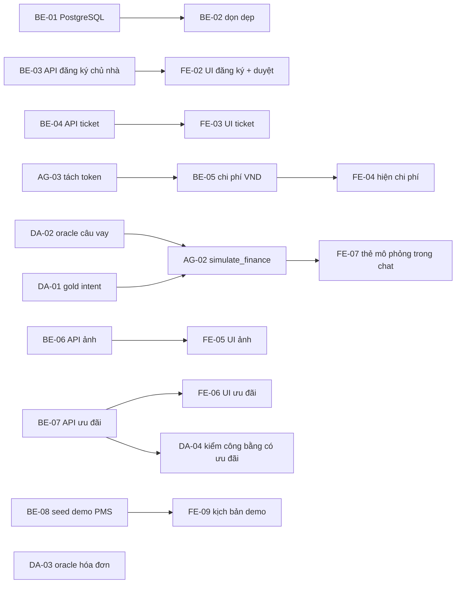

# Coding plan HomeMatch — phần chung cho mọi mảng

**Ngày lập:** 06/10/2026. **Trạng thái code lúc lập plan:**
- schema v9, 89 đường dẫn API;
- `bash infra/check-local.sh` exit 0: 196 test Python pass, 4 skip, 41 test UI pass.

Plan chia thành bốn mảng. Mỗi mảng có thể giao cho một AI coding agent riêng và chạy song song:

| Mảng | File plan | Mã task |
|---|---|---|
| Backend (API, DB, quyền, PMS, hạ tầng) | [be.md](be.md) | `BE-xx` |
| Frontend (React UI) | [fe.md](fe.md) | `FE-xx` |
| AI Agent (chat graph, interpreter, tool, LLM, embedding) | [agent.md](agent.md) | `AG-xx` |
| Dữ liệu và đánh giá (`data/`, `eval/`) | [data.md](data.md) | `DA-xx` |

**Cách dùng:** mỗi agent đọc **file này trước**, rồi chỉ làm trong file của mảng mình. Ví dụ, giao cho agent backend câu: "Đọc `docs/coding-plan/README.md` và `docs/coding-plan/be.md`, làm từ BE-01".

---

## 1. Đọc trước khi code

1. `CLAUDE.md`: lệnh, kiến trúc, bất biến. Đây là nguồn sự thật cho quy tắc code.
2. `CONTEXT.md`: thuật ngữ (khách, chủ nhà, admin, run, HITL, lease, invoice...).
3. `docs/yeu-cau-san-pham.md`: FR/NFR kèm hiện trạng.
4. `docs/api-contract.md`: API đang có. `docs/api-san-pham-v1.md`: API còn thiếu.
5. Code mẫu của mảng mình, ghi ở đầu mỗi file plan.

## 2. Phân quyền thư mục (chống đụng nhau khi chạy song song)

| Mảng | Được sửa | Không được sửa |
|---|---|---|
| BE | `backend/app/*` **trừ** các file của AG; `backend/tests/*` (trừ test của AG); `backend/manage.py`; `infra/*`; `requirements*` | `frontend/`, `data/`, `eval/` |
| AG | `backend/app/interpreter.py`, `agents.py`, `agent_guard.py`, `agent_budget.py`, `agent_provenance.py`, `semantic.py`, `memory.py`; trong `service.py` **chỉ** hàm `_build_chat_graph`; test `test_interpreter*.py`, `test_agents_memory.py`, `test_agent_*.py`, `test_finance_chat.py` | Migration, route trong `main.py` (nhờ BE nếu cần) |
| FE | `frontend/*` | Mọi thứ ngoài `frontend/` |
| DA | `data/*`, `eval/*` | `backend/`, `frontend/` |

**Ngoại lệ đã được cho phép trong plan (ghi lại trong báo cáo khi dùng):**
- AG-03 sửa `backend/app/operations.py` (ghi usage token).
- DA-01 và DA-03 thêm một bước vào `infra/check-local.sh`.
- AG-02 sửa `Literal` trong `models.py` và `schemas.py`, cùng trường `simulation` của `MessageResult`.

**File dùng chung, chỉ sửa đúng phần ghi bên dưới:**
- `backend/app/schemas.py`, `backend/app/models.py`: BE sở hữu. AG chỉ được thêm giá trị vào các `Literal` intent và status của chat.
- `backend/app/agent_capability.py`: BE sở hữu.
- `docs/*`: mỗi mảng chỉ cập nhật dòng FR/AC và mục thuộc task của mình. `docs/openapi.json` chỉ BE sinh lại.
- **Migration** (`backend/app/migrations.py`): **chỉ BE thêm.** Mỗi migration dùng số `MIGRATIONS[-1][0] + 1` ở thời điểm làm; không sửa migration cũ.

Khi task cần sửa ngoài vùng của mình: dừng phần đó, ghi vào mục "Câu hỏi / phụ thuộc" trong báo cáo, rồi làm tiếp phần còn lại.

## 3. Luật cứng (vi phạm là task không đạt)

| # | Luật |
|---|---|
| L1 | **Không gọi API trả phí** (OpenAI) trong test hoặc khi tự kiểm. `backend/tests/conftest.py` đặt sẵn chế độ offline. Mọi thứ live chỉ được **chuẩn bị**, người dùng tự chạy. |
| L2 | **Không commit, không push**, trừ khi người dùng yêu cầu rõ. |
| L3 | **Tiền** chỉ tính trong `costs.py` hoặc `pms.py`, dùng `Decimal` và làm tròn VND như hiện có. Khoản chưa biết là `None`, không bao giờ là 0. |
| L4 | **Thu nhập và tỷ lệ chi tiêu trên thu nhập** của khách không bao giờ được xuất hiện ở: DTO của chủ nhà, ngữ cảnh chuyển giao, prompt LLM, embedding, log. |
| L5 | **Quyền theo bản ghi:** chủ nhà chỉ thấy dữ liệu phòng của mình; khách chỉ thấy dữ liệu của mình. Mỗi endpoint mới phải có test chặn người ngoài (403/404). |
| L6 | **Lỗi nghiệp vụ** dùng `DomainError(code, message_vi, status)`. Body API dùng Pydantic. |
| L7 | **Một API worker.** Không thêm worker, queue hay WebSocket. |
| L8 | **Không ghi là "đã kiểm chứng"** khi chưa chạy thật (GPT live, PostgreSQL, Railway, trình duyệt). |
| L9 | **SQL** dùng placeholder `?`, phải chạy được trên cả SQLite và PostgreSQL; kiểu cột chỉ `TEXT`/`INTEGER`. |
| L10 | **Văn bản cho người dùng** viết tiếng Việt có dấu. Code và comment viết tiếng Anh, theo mật độ comment của file xung quanh. |
| L11 | **Không đưa bí mật** vào repo. Biến môi trường mới phải ghi vào `infra/env-inventory.md`. |
| L12 | **Xếp hạng** không dùng thuộc tính thương mại (hoa hồng, thời gian tồn, ưu đãi). `eval invariants` phải giữ 0 vi phạm. |
| L13 | **Dữ liệu tổng hợp** luôn gắn nhãn tổng hợp. Không dùng `data/crawl_chotot.py`, vì chưa có quyền dùng dữ liệu đó. |

## 4. Lệnh

```bash
# Cài (một lần)
python3 -m venv .venv && .venv/bin/python -m pip install -r requirements.lock
npm --prefix frontend ci

# Kiểm nhanh
.venv/bin/python -m pytest backend/tests/test_<file>.py -q
npm --prefix frontend test -- src/tests/<file>.test.tsx
npm --prefix frontend run typecheck

# Cổng cuối của MỌI task (phải exit 0)
bash infra/check-local.sh

# Sinh lại OpenAPI (chỉ BE, khi đổi API)
.venv/bin/python -c "import json;from backend.app.main import create_app;json.dump(create_app().openapi(),open('docs/openapi.json','w'),ensure_ascii=False,indent=2)"
```

## 5. Định nghĩa "xong" (mọi task)

1. Code và test mới nằm trong cùng thay đổi; test mới fail khi bỏ code mới.
2. `bash infra/check-local.sh` exit 0. Ghi lại số test pass.
3. Đổi API: BE sinh lại `docs/openapi.json` và cập nhật `docs/api-contract.md`. Xóa mục đã xong khỏi `docs/api-san-pham-v1.md`.
4. Cập nhật hiện trạng FR/AC trong `docs/yeu-cau-san-pham.md` và `docs/trang-thai-trien-khai.md`, ghi ngày.
5. Báo cáo theo mẫu ở §9.

## 6. Thứ tự và phụ thuộc giữa các mảng



- **FE không cần chờ BE xong.** FE code theo hợp đồng API ở §7 và test bằng mock (`vi.spyOn(api, "get")`). Khi BE xong, FE kiểm lại tên trường với `docs/openapi.json`.
- **AG-02 cần DA-02** (file oracle). Nếu DA-02 chưa xong, AG tự viết test tạm bằng các ca trong §7.4 rồi chuyển sang dùng file oracle sau.
- **Thứ tự gộp khi tích hợp:** BE → AG → DA → FE. Sau mỗi lần gộp chạy `bash infra/check-local.sh`.

## 7. Hợp đồng API dùng chung

Tên trường dưới đây là cam kết giữa BE và FE, và giữa AG và FE. Muốn đổi thì cập nhật file này **trước** khi code.

### 7.1 Đăng ký chủ nhà (BE-03 ↔ FE-02)

```
POST /auth/register
  body: {username, password, email, display_name?, account_type: "renter"|"owner" = "renter"}
  201: {status:"pending_verification", user:{id, role}, delivery}
  422 khi account_type khác hai giá trị trên

GET  /auth/me → Actor + landlord_status: null|"pending"|"approved"|"rejected"

GET  /admin/landlord-applications?status=pending
  200: [{user_id, email, display_name, landlord_status, created_at, verified: bool}]
POST /admin/landlord-applications/{user_id}/approve   200: {user_id, landlord_status:"approved"}
POST /admin/landlord-applications/{user_id}/reject {reason}   200: {user_id, landlord_status:"rejected"}

Chủ nhà chưa được duyệt mà đặt published=true → 403 {error:{code:"landlord_not_approved"}}
```

### 7.2 Ticket hỗ trợ (BE-04 ↔ FE-03)

```
GET   /admin/support-tickets?status=requested|in_progress|resolved
  200: [{id, session_id, status, assignee, note, created_at, updated_at, resolved_at}]
PATCH /admin/support-tickets/{id} {status, note?}
  200: ticket; chuyển trạng thái sai → 409 ticket_state; resolved mà thiếu note → 422 note_required
```

### 7.3 Chi phí VND (BE-05 ↔ FE-04)

```
GET /admin/metrics → thêm
  cost: {estimated_cost_vnd: int|null, price_effective_date: str|null, missing: [str], basis: {...}}
```

### 7.4 Mô phỏng vay qua chat (AG-02 ↔ FE-07)

```
POST /sessions/{id}/messages {text}
  MessageResult.intent thêm "simulate_finance"
  MessageResult.status thêm "simulation" | "needs_results"
  MessageResult.simulation: {room_id, room_title, scenario:{annual_rate, term_months, principal_vnd},
                             result:<giống 1 phần tử kết quả của POST /sessions/{id}/simulate>} | null
  MessageResult.message: câu trả lời tiếng Việt
```

Ca mẫu để parse câu hỏi (DA-02 sẽ đưa vào file oracle):

| Câu | term_months | annual_rate | principal_vnd |
|---|---|---|---|
| "nếu vay 12 tháng thì sao" | 12 | null | null |
| "vay 20 triệu lãi 10% trong 6 tháng" | 6 | 10 | 20000000 |
| "trả góp 24 tháng lãi suất 12,5%" | 24 | 12.5 | null |

### 7.5 Ảnh (BE-06 ↔ FE-05)

```
POST   /landlord/rooms/{id}/media   multipart field "file" → 201 {id, url:"/media/{id}", content_type, size_bytes, position}
DELETE /landlord/rooms/{id}/media/{media_id} → 204
PATCH  /landlord/rooms/{id}/media/order {media_ids:[...]} → 200 [media...]
POST   /maintenance/{id}/media      multipart "file" → 201 media
GET    /media/{id}                  → file ảnh (ảnh tin công khai không cần token)
GET /listings, /listings/{id}, /landlord/rooms/{id}, /maintenance → thêm photos:[{id,url}]
Lỗi: 422 invalid_media, 422 media_too_large, 422 media_limit
```

### 7.6 Ưu đãi (BE-07 ↔ FE-06)

```
PUT    /landlord/rooms/{id}/promotion {text (1–200), valid_until "YYYY-MM-DD"} → 200 {room_id, text, valid_until}
DELETE /landlord/rooms/{id}/promotion → 204
GET /listings, /listings/{id}, /landlord/rooms/{id} → thêm promotion:{text, valid_until}|null (chỉ khi còn hạn)
```

## 8. Bản đồ code

| Việc | File |
|---|---|
| Route, auth bearer, job nền | `backend/app/main.py` (`create_app`) |
| Nghiệp vụ, quyền, hai graph | `backend/app/service.py` (`HomeMatchService`; `_build_chat_graph` ~dòng 1173; `_build_recommendation_graph` ~1283) |
| Ma trận quyền | `backend/app/agent_capability.py` (`require(cap, actor, resource?)`), `capabilities.py` |
| DB | `repository.py`, `database.py`, `migrations.py` |
| Tài khoản | `auth.py` (`register_account`, `verify_account`, `SEED_USERS`), `organizations.py` |
| Interpreter, ý định | `interpreter.py` (`fixed_intent`, `DemoInterpreter`, `OpenAIInterpreter`) |
| Tool của agent | `agents.py` (`AGENT_TOOLS`, `MAX_STEPS = 4`) |
| Số liệu vận hành | `operations.py` |
| PMS, tự động hóa, thông báo | `pms.py`, `automation.py`, `notifications.py` (`notify(repo, user, kind, title, body, dedup_key, link)`) |
| CLI | `backend/manage.py` (`setup`, `migrate`, `import`, `index`, `seed-users`, `jobs`) |
| Fixture test BE | `backend/tests/conftest.py`: `service`, `renter`, `landlord` (owner-a), `admin`, `profile`, `storage` |
| API client FE | `frontend/src/api.ts`; route FE: `frontend/src/App.tsx` |
| Dữ liệu và eval | `data/generate.py`, `data/profiles/`, `data/oracles/`, `data/manifests/`; `eval/pipeline.py`, `eval/suites.py`, `eval/__main__.py` |

## 9. Mẫu báo cáo sau mỗi task

```
Task: <BE|FE|AG|DA>-xx — <tên>
Đã làm: <thay đổi chính, file>
Migration: v<số> <tên> (nếu có)
Test mới: <file::test>, …
Kiểm: bash infra/check-local.sh → exit 0; pytest N passed / M skipped; Vitest K passed
Chưa kiểm / giới hạn: <PostgreSQL? trình duyệt? live?>
Docs đã cập nhật: <danh sách>
Câu hỏi / phụ thuộc mảng khác: <nếu có>
```
