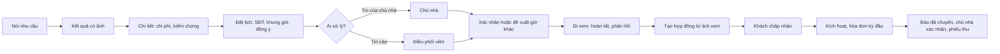

# Coding plan — Luồng thuê phòng end-to-end (E2E)

**Ngày lập:** 07/11/2026. **Làm sau** [crawl.md](crawl.md), vì cần `source_images` (CA-04..06).

**Mục tiêu:** một người thuê đi hết một mạch, không phải rời luồng và không gặp ngõ cụt:



## 1. Hiện trạng (đọc code 07/11/2026)

`infra.smoke_api --in-process` chạy qua được luồng API hiện có. Các chỗ đứt:

| # | Chỗ đứt | Bằng chứng |
|---|---|---|
| G1 | **Tin cào là ngõ cụt.** Lịch xem gửi tới tài khoản demo `owner-a..d`, người đăng thật không hề biết | `request_listing_viewing` dùng `room.landlord`; `service.py:1421` |
| G2 | Lịch xem chỉ có `requested/confirmed/declined`: không đổi giờ, hủy, hoàn tất, vắng mặt, phản hồi | `respond_viewing`, `service.py:1567`; `ViewingResult`, `schemas.py:204` |
| G3 | Chủ nhà phải tự gõ mã tài khoản người thuê khi tạo hợp đồng; lịch xem và hợp đồng không nối với nhau | `Pms.tsx:327-330`; `pms.create_lease` |
| G4 | Không có kiểm chứng tin | Không có trong `Room` hay trang chi tiết |
| G5 | Không có báo cáo tin đăng | Không tìm thấy route hoặc UI |
| G6 | Chưa có khung giờ, SĐT và đồng ý chia sẻ liên hệ khi đặt lịch | `request_listing_viewing` chỉ nhận `requested_at`, `mode` |
| G7 | Chưa có giá mỗi m², mặt bằng khu trên trang chi tiết, chỗ ở tương tự, câu hỏi gợi ý theo căn | Chưa thấy trong `SearchPage.tsx`, `PublicListing.tsx` |

Từ `hm_leases` trở đi (hợp đồng, chấp nhận, hóa đơn, thanh toán, phiếu thu) đã có và có test: **không viết lại**.

## 2. Chức năng cần có

| Chức năng | Task |
|---|---|
| Khách để lại liên hệ, nhân viên xác nhận lịch, không cần chủ nhà online | E-02 |
| Ngày giờ khách chọn chỉ là mong muốn; có khung giờ | E-01, E-07 |
| Địa chỉ chi tiết chỉ mở sau khi xác nhận lịch | E-03 |
| Kiểm chứng tự động, ghi rõ "không phải chứng nhận"; có mục "chưa kiểm được" | E-04 |
| Số liệu người đăng, không chấm điểm | E-04 |
| Báo tin có vấn đề, cảnh báo không chuyển tiền trước khi xem | E-05, E-06 |
| Giá mỗi m², so với mặt bằng, chỗ ở tương tự, câu hỏi gợi ý theo căn | E-06 |

**Tránh các lỗi sau:**

1. Mô tả ghi "Dịch vụ 200k, xe 100k" nhưng bảng chi phí ghi "Tin chưa nêu".
2. Trang hứa ẩn địa chỉ nhưng mô tả vẫn hiện số nhà.
3. Thẻ tiện ích có mục mô tả không nói tới.

## 3. Luật (vi phạm là task không đạt)

| # | Luật |
|---|---|
| R1 | **Mọi câu chữ, dữ liệu và hình ảnh tự làm.** Không chép của sản phẩm khác. |
| R2 | **Không lưu, không lấy SĐT người đăng tin cào.** Không gọi endpoint chi tiết Chợ Tốt. Điều phối viên tự mở tin gốc bằng tay qua `source`. |
| R3 | **SĐT người thuê chỉ dùng cho lịch xem đó**, có đồng ý rõ ràng, không vào LLM, embedding, memory, log. Chủ nhà chỉ thấy sau khi đã xác nhận lịch; mọi lượt admin xem đều audit. |
| R4 | **Kiểm chứng không vào xếp hạng** và là code tất định. Mỗi mục có đúng ba trạng thái `ok/warn/unknown`. Không có điểm tổng, không kết luận "lừa đảo" hay "đã xác minh". |
| R5 | **Giữ bất biến trong `CLAUDE.md`**: phí chưa biết là `null`, thu nhập không tới chủ nhà, quyền theo bản ghi, hóa đơn bất biến, mutation key, một API worker. |
| R6 | **Không tích hợp ngoài (D-07):** không gửi SMS hay email thật. Chỉ thông báo trong app. |
| R7 | **Không gọi API trả phí, không ghi Neon, không commit** khi code. Không revert thay đổi có sẵn của người dùng. |
| R8 | Migration mới bắt đầu từ số kế tiếp trong `migrations.py` (hiện 21). Dữ liệu `hm_viewings` cũ vẫn đọc được. Chạy được trên cả SQLite và PostgreSQL. |

## 4. Các task

Làm theo thứ tự. Mỗi task: viết test, sửa code, chạy test liên quan, báo cáo theo mẫu ở [crawl.md](crawl.md) mục 6.

| ID | Task | Ưu tiên | Giải quyết |
|---|---|---|---|
| E-01 | Vòng đời lịch xem | P0 | G2, G6 |
| E-02 | Điều phối tin cào | P0 | G1 |
| E-03 | Che và mở địa chỉ chi tiết | P1 | Lỗi 2 |
| E-04 | Kiểm chứng tin | P0 | G4 |
| E-05 | Báo cáo tin đăng | P1 | G5 |
| E-06 | Hoàn thiện trang chi tiết | P1 | G7, lỗi 1 và 3 |
| E-07 | Giao diện lịch xem hai phía | P0 | G2, G6 |
| E-08 | Tạo hợp đồng từ lịch xem | P0 | G3 |
| E-09 | Test và kịch bản end-to-end | P0 | Toàn luồng |
| E-10 | Gán tin cào cho chủ nhà thật | P2, **hỏi người dùng trước** | G1 |

### E-01 — Vòng đời lịch xem

Trạng thái và chuyển trạng thái; sai thì trả `DomainError` 409, kiểm tra cả CAS:

```text
requested  → confirmed | declined | reschedule_proposed | cancelled
reschedule_proposed → confirmed (khách đồng ý) | cancelled | requested (khách chọn giờ khác)
confirmed  → completed | no_show | cancelled | reschedule_proposed
```

1. Thêm vào yêu cầu đặt lịch: `contact_name`, `contact_phone` (dùng `normalize_phone` có sẵn), `time_slot`, `note` tùy chọn, `contact_consent` bắt buộc `true`.
2. Lưu lịch sử chuyển trạng thái: ai, lúc nào, từ đâu sang đâu, lý do.
3. Route mới cho khách: hủy, chấp nhận giờ đề xuất, phản hồi sau khi xem (`completed` mới gửi được: đánh giá 1–5 và ghi chú).
4. Route mới cho bên xử lý: đề xuất giờ khác, đánh dấu hoàn tất hoặc vắng mặt.
5. Đặt lại cùng `idempotency_key` trả về lịch cũ. Mỗi chuyển trạng thái có thông báo trong app với dedup key.
6. Giữ kiểm tra `stale_viewing` hiện có khi xác nhận. Job nhắc lịch xem chỉ chạy với `confirmed`.
7. `_viewing_projection`: chủ nhà chỉ thấy tên và SĐT khách từ `confirmed` trở đi. Đồng bộ `docs/status-dictionary.md`.

**Test:** mọi chuyển trạng thái hợp lệ và không hợp lệ; quyền từng vai; thiếu đồng ý bị từ chối; SĐT không lộ trước khi xác nhận và không có trong prompt, log, handover.

### E-02 — Điều phối tin cào

1. `handler = "concierge"` khi `room.source` thuộc `listings.CRAWLED_SOURCE_PREFIXES`, ngược lại `"landlord"`. Lịch `concierge` **không** thông báo và không hiện cho tài khoản demo.
2. Trang admin mới `/quan-tri/dieu-phoi`: hàng đợi lịch `concierge` theo thời gian. Mỗi dòng có tên phòng, giờ mong muốn, link tin gốc, nút "Xem SĐT khách" (audit từng lần), các nút chuyển trạng thái, ô ghi chú.
3. Thêm capability trong `capabilities.py` cho admin. Manager cũ không có quyền.
4. Chỉ có admin thao tác, giao diện ghi rõ: người điều phối tự liên hệ người đăng qua tin gốc. Không có nút gọi hay nhắn tự động.
5. Khách thấy thông điệp đúng sự thật: "HomeMatch sẽ liên hệ người đăng để xác nhận; đây chưa phải lịch đã chốt". Chat không được nói "đã đặt lịch" (giữ `agent_guard`).
6. Sửa `_listing_contact` nếu cần để khối `contact` có `kind: "external"` cùng nút đặt lịch qua điều phối.

**Test:** tin cào vào hàng đợi admin; `owner-a` không thấy lịch đó; tin chủ nhà vẫn đi như cũ; mỗi lượt xem SĐT có audit.

### E-03 — Che và mở địa chỉ chi tiết

1. Hàm `mask_address(text, street)` trong `listings.py`: best-effort che số nhà đứng trước tên đường và dạng `\d+(/\d+)+`. Có test với mẫu thực tế tự viết.
2. Áp lúc trả response (snapshot bất biến, không đổi dữ liệu lưu) cho `description`, `title`, `street` ở mọi đầu ra công khai và khi gửi model.
3. Khách của lịch `confirmed` thấy bản đầy đủ qua trường riêng ở `/viewings/{id}`. Ghi rõ trên UI "Địa chỉ có thể còn sót trong mô tả; đây là che tự động".
4. Không được làm vỡ `extract_fees` (chạy trên văn bản gốc lúc crawl) và số tiền trong mô tả.

### E-04 — Kiểm chứng tin

File mới `backend/app/trust.py`, hàm thuần, tính từ catalog và cache theo `catalog.version`. **Không truy vấn từng dòng** (Neon chậm). Trả về `{key, status, detail}`:

| Key | `ok` | `warn` | `unknown` |
|---|---|---|---|
| `completeness` | Đủ ảnh, giá, diện tích, cọc, phí chính | Thiếu một phần, liệt kê mục thiếu | — |
| `price_vs_area` | Trong khoảng so với trung vị cùng thành phố, khu, loại | Lệch quá ngưỡng, nêu % | Nhóm dưới 5 tin |
| `duplicate` | Không trùng | Trùng tiêu đề chuẩn hóa + giá + khu | — |
| `image_reuse` | URL ảnh không ở tin khác | Mã file ảnh trùng tin khác | Không có ảnh |
| `prepay_request` | Không có câu đòi cọc trước khi xem | Có; không trích số điện thoại | — |
| `title_consistency` | Giá, diện tích trong tiêu đề khớp tin | Lệch | Tiêu đề không ghi |
| `freshness` | Đăng trong 30 ngày | Quá 30 ngày | Không có `posted_at` |
| `reports` | Không có báo cáo đã xác nhận | Có | — |
| `ownership` | — | — | Luôn `unknown` với tin cào: "chưa đối chiếu giấy tờ" |

1. Ngưỡng là hằng số đặt tên rõ. Ảnh chỉ so URL hoặc tên file, không tải ảnh (không tuyên bố đối chiếu băm ảnh).
2. Trả trong `GET /listings/{id}`, không trong danh sách. Kèm câu "tính tự động, không phải chứng nhận".
3. Thêm đột biến vào `eval invariants`: thay kết quả kiểm chứng không làm đổi thứ hạng.

**Test:** mỗi key đủ các trạng thái; dữ liệu thiếu cho `unknown`, không bao giờ `ok`.

### E-05 — Báo cáo tin đăng

1. `POST /listings/{id}/reports`, cần đăng nhập, có lý do (danh sách cố định) và ghi chú đã qua `mask_pii`. Một tài khoản báo một tin một lần.
2. Admin xem ở `/quan-tri/tin-dang`: xác nhận hoặc bác. Xác nhận nối với luồng kiểm duyệt có sẵn; báo cáo đã xác nhận hiện ở mục `reports`.
3. Không ẩn tin tự động theo số báo cáo (tránh lạm dụng).

### E-06 — Hoàn thiện trang chi tiết

1. **Phí nhất quán (lỗi 1):** thêm test `extract_fees` với mẫu tự viết kiểu "Dịch vụ 200k/phòng", "Xe 100k/chiếc", "Nước 120k/người", "Điện 4k/kWh". Sửa luật nếu trượt. Phí vẫn `null` khi không đọc được; **không điền số ước tính vào tổng**. Phí trên tin cào cũ chỉ đổi ở snapshot mới.
2. **Tiện ích nhất quán (lỗi 3):** thêm dòng "Theo nội dung tin"; chỉ hiện `true`, không hiện mục `null`.
3. Hiện giá mỗi m² và vị trí so với trung vị khu (dùng chung số với `price_vs_area`), phía server.
4. "Chỗ ở tương tự": tối đa 3 căn cùng thành phố, loại và mức giá gần, không đi qua LLM, không dùng `posted_at`.
5. Câu hỏi gợi ý mở chat với `room_id`: tổng chi phí, giá có hợp lý, phù hợp với ai. Câu trả lời đi qua agent có sẵn.
6. Nút báo cáo, cảnh báo cố định không chuyển tiền trước khi xem và nhãn trạng thái xác minh.

### E-07 — Giao diện lịch xem hai phía

1. Form đặt lịch dùng chung ở trang chi tiết, tìm kiếm và chat: ngày, 3 khung giờ, họ tên và SĐT điền sẵn từ tài khoản, ô đồng ý. Nói rõ đây là thời gian mong muốn.
2. `/nguoi-thue/lich-xem`: dòng thời gian từng lịch, việc cần làm tiếp theo (chấp nhận giờ mới, hủy, phản hồi, xem hợp đồng).
3. `/chu-nha/lich-xem`: đủ thao tác mới; `/quan-tri/dieu-phoi` theo E-02.
4. Có trạng thái tải, rỗng, lỗi; đúng ở 360 px. Không tính quyền ở frontend. Dùng `mutationKey()`.

**Test Vitest** cho từng trạng thái và việc cần làm tương ứng.

### E-08 — Tạo hợp đồng từ lịch xem

1. Lịch `completed` thuộc tin chủ nhà có nút "Tạo hợp đồng". Mở form đã điền sẵn phòng, người thuê, giá, cọc; bỏ việc gõ mã tài khoản ở luồng này.
2. Thêm `viewing_id` tùy chọn vào `LeaseInput`; server kiểm tra lịch thuộc chủ nhà, đúng phòng, đã `completed` và lấy `renter_id` từ lịch.
3. Lịch xem của khách hiện link hợp đồng khi đã gửi.
4. Tin `concierge` không có nút này. Giao diện báo: "Tin cào: hợp đồng ký trực tiếp với người đăng, ngoài hệ thống" (trừ khi có E-10).

### E-09 — Test và kịch bản end-to-end

1. `backend/tests/test_e2e_rental_flow.py`, offline qua `TestClient`, chạy bằng đúng API thật:
   - **Nhánh chủ nhà:** chat và xác nhận hồ sơ → kết quả → chi tiết có kiểm chứng → đặt lịch → đề xuất giờ khác → khách đồng ý → hoàn tất → phản hồi → hợp đồng từ lịch → gửi → chấp nhận → kích hoạt → ghi số điện nước → hóa đơn → báo đã chuyển → xác nhận → phiếu thu.
   - **Nhánh tin cào:** catalog giả có `source` Chợ Tốt → đặt lịch → hàng đợi admin → xác nhận → hoàn tất → phản hồi; `owner-*` không thấy gì.
   - **Nhánh lỗi:** phòng hết trong lúc chờ, hủy, vắng mặt, sửa hồ sơ làm lịch cũ hết hiệu lực.
2. Vitest cho luồng UI chính.
3. Thêm hai nhánh vào `infra/smoke_api.py` và `docs/kich-ban-demo.md`.
4. Không tuyên bố "đã chạy trình duyệt" nếu chưa chạy.

### E-10 — Gán tin cào cho chủ nhà thật (P2)

**Dừng lại hỏi người dùng trước khi làm.** Ý tưởng: admin chuyển một tin cào cho tài khoản chủ nhà đã duyệt, sau khi chủ nhà xác minh là người đăng; tin chuyển sang `handler = "landlord"`, chạy được tới hợp đồng. Cần thiết kế cách chứng minh quyền sở hữu tin.

## 5. Định nghĩa "xong"

Toàn bộ lệnh ở [crawl.md](crawl.md) mục 5 đều xanh, cộng thêm:

```bash
.venv/bin/python -m pytest backend/tests/test_e2e_rental_flow.py
```

```bash
.venv/bin/python -m infra.smoke_api --in-process
```

Việc chỉ người dùng làm được: chạy trên trình duyệt với catalog Chợ Tốt mới và quay video demo theo `docs/kich-ban-demo.md`.
