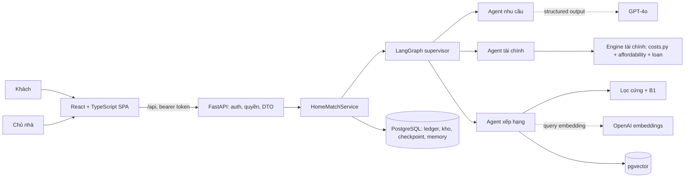

# Kiến trúc đích HomeMatch AI Agent

**Cập nhật:** 05/10/2026 (sau E1–E6). Kiến trúc cần đạt khi deploy và chạy live. Phần lớn thành phần đã có trong code; xem [kiến trúc đang chạy](kien-truc-trien-khai.md). Mục tiêu ban đầu là hoàn thành GĐ1–GĐ4 ([kế hoạch](ke-hoach-trien-khai.md)). Kiến trúc đang chạy (0.4.0) nằm ở [kien-truc-trien-khai.md](kien-truc-trien-khai.md).

## 1. Thành phần

- **Modular monolith:** một backend FastAPI, một API worker cho tới khi kiểm chứng xong concurrency của checkpoint.
- **PostgreSQL** chứa ledger (phiên, hồ sơ, run, quyết định duyệt, lịch xem), kho căn có revision, checkpoint LangGraph, vector căn, cache embedding truy vấn và memory sở thích.
- **SQLite + chế độ demo** dùng cho phát triển, test và demo offline. Không dùng để công bố số liệu chất lượng.

## 2. Ranh giới trách nhiệm

| Lớp | Quyết định | Không quyết định |
|---|---|---|
| Frontend | Hiển thị DTO, thu thập xác nhận, so sánh, mô phỏng (gọi API) | Tính tiền, xếp hạng, cấp quyền, công bố |
| API | Xác thực token, kiểm vai trò và phân công, envelope lỗi, request ID | Nghiệp vụ xếp hạng |
| Service | Giao dịch, CAS/revision, idempotency, kiểm phiên bản trước khi công bố | Diễn đạt ngôn ngữ |
| Agent (LangGraph) | Định tuyến, hỏi lại, gọi tool, soạn lý do từ dữ liệu | Số tiền, điều kiện cứng, duyệt |
| Engine tài chính, catalog | Số học `Decimal`, lọc cứng, B1/P | Văn bản tự do |

## 3. Dữ liệu chính

| Bảng | Nội dung | Ghi chú |
|---|---|---|
| `hm_users`, `hm_tokens`, `hm_account_profiles`, `hm_verification_tokens` | Tài khoản, hash mật khẩu scrypt, hash token, đồng ý, mã xác minh | Đã có |
| `hm_sessions`, `hm_profile_snapshots` | Nháp và revision, hồ sơ đã xác nhận theo phiên bản | Đã có |
| `hm_runs`, `hm_run_reviews` | Snapshot hồ sơ, phiên bản kho, nháp; quyết định của từng chủ nhà kèm `agent_order` | Đã có |
| `hm_rooms`, `hm_catalog_meta` | Kho căn, revision, phiên bản kho | Đã có. Đích: `property_type`, `bedrooms`, Hà Nội |
| `hm_viewings`, `hm_support` | Yêu cầu xem căn, yêu cầu gặp người thật | Đã có |
| `hm_embeddings` | Vector căn kèm hash văn bản semantic, model, số chiều | Đã có ở chế độ PG |
| `hm_query_embeddings` | Cache embedding truy vấn | Đã có (v4) |
| `hm_preference_memory` | Memory sở thích theo người dùng, có đồng ý | Đã có (v4) |
| `hm_audit_log` | Audit thay đổi quyền và tài khoản | Đã có |

## 4. Bảo mật

- Token ngẫu nhiên, server lưu hash SHA-256, có hạn và thu hồi được. Không dùng JWT.
- Kiểm quyền theo bản ghi ở service: chủ phiên; chủ nhà của phòng (danh sách AI, lịch, chat, hợp đồng, hóa đơn, sự cố); admin cho console. Ma trận quyền nằm trong `agent_capability.py` và `capabilities.py`.
- Dữ liệu tài chính: xem [tai-chinh-thue.md](tai-chinh-thue.md#8-bảo-mật-dữ-liệu-tài-chính). Log dùng route mẫu, không ghi body, query, token hay chat.
- Không tự đọc `.env`. Secret nằm trong biến môi trường server (Railway variables).

## 5. Triển khai Railway

| Dịch vụ | Cấu hình |
|---|---|
| API | `infra/Dockerfile.api`, `infra/railway.toml`, một worker, healthcheck `/ready` |
| PostgreSQL | Image có extension `vector`, volume bền, backup riêng |
| Frontend | `infra/Dockerfile.frontend` + Nginx, hoặc host tĩnh, trỏ `VITE_API_BASE_URL` tới API |

Biến môi trường chính:

- `HOMEMATCH_DATABASE_URL`;
- `HOMEMATCH_AUTH_MODE=seed`, `HOMEMATCH_PUBLIC=true`, mật khẩu seed mạnh;
- `HOMEMATCH_LLM_MODE=openai`, `OPENAI_API_KEY`;
- `HOMEMATCH_EMBEDDING_MODE=openai`, `HOMEMATCH_MATCHING_METHOD=P`;
- `HOMEMATCH_CORS_ORIGINS`.

Danh sách đầy đủ ở [env-inventory](../infra/env-inventory.md). Hướng dẫn chuẩn bị ở [deploy-railway](../infra/deploy-railway.md).

## 6. Quyết định kiến trúc

| Quyết định | Lý do | Hệ quả |
|---|---|---|
| LangGraph + `interrupt()` cho HITL | Dừng và tiếp tục có checkpoint; mỗi chủ nhà quyết định riêng, graph chỉ chạy tiếp khi mọi chủ nhà đã quyết định | Node trước interrupt không được ghi |
| Quyết định commit vào ledger trước khi resume | Không mất hay nhân đôi quyết định khi lỗi | Có trạng thái `reviewed` và thao tác retry |
| Lọc cứng trước semantic | Đúng ràng buộc và giảm chi phí embedding | B1 và P so sánh công bằng trên cùng tập |
| Engine tài chính tách khỏi LLM | Đúng đến VND và kiểm chứng được bằng oracle | LLM chỉ giải thích kết quả |
| Một worker | Checkpoint và khóa kho chưa kiểm chứng đa tiến trình | Giới hạn khả năng mở rộng ngang |
