# Đặc tả sản phẩm HomeMatch v1

**Ngày:** 04/10/2026. **Trạng thái:** đặc tả đích, chưa nghiệm thu. **Quyết định phạm vi:** xây sản phẩm hoàn thiện theo yêu cầu của người dùng, thay thế kế hoạch MVP gọn trước đây.

## 1. Sản phẩm và giá trị

HomeMatch là nền tảng tìm và quản lý thuê phòng trọ, studio tại TP.HCM. Người thuê tìm phòng phù hợp với nhu cầu và tổng chi phí, lưu/so sánh lựa chọn, đặt lịch xem, theo dõi hợp đồng và các khoản phải trả, gửi yêu cầu sửa chữa. Chủ nhà quản lý nguồn phòng và quá trình cho thuê. Quản lý phụ trách kiểm duyệt, tư vấn, xác nhận và xử lý vận hành. Quản trị viên kiểm soát tài khoản, phân quyền và hoạt động hệ thống.

Sản phẩm giải quyết ba khoảng đứt trong hành trình thuê: nhu cầu diễn đạt tự nhiên chưa thành tiêu chí rõ; giá thuê chưa phản ánh tổng khoản phải chuẩn bị/trả hàng tháng; thông tin từ tìm phòng tới hợp đồng và vận hành bị tách rời. Mỗi quyết định phải truy về hồ sơ, phiên bản tin, điều khoản hoặc chứng từ liên quan.

HubHome là nguồn tham khảo trải nghiệm và danh mục nghiệp vụ. [Nghiên cứu HubHome](nghien-cuu-hubhome.md) ghi riêng quan sát, công bố của website và phần chưa xác minh. Công nghệ backend, dữ liệu, số lượng công cụ hay chất lượng của HubHome không phải bằng chứng về HomeMatch.

## 2. Người dùng và trách nhiệm

| Vai trò | Kết quả cần đạt | Phạm vi trách nhiệm |
|---|---|---|
| Khách chưa đăng nhập | Khám phá tin đã công bố và hiểu cách dùng | Xem catalog công khai, lọc, bản đồ, chi phí mẫu; đăng nhập trước hành động lưu hoặc giao dịch |
| Người thuê `renter` | Chọn phòng và quản lý việc thuê của mình | Hồ sơ, hội thoại, danh sách lưu, lịch xem, chấp thuận điều khoản, hóa đơn, chứng từ, sửa chữa |
| Chủ nhà `owner` | Quản lý phòng và khách thuê trong đơn vị của mình | Tạo tin, cập nhật nguồn phí/tình trạng, đề xuất lịch, điều khoản, công tơ, hóa đơn và công việc được giao |
| Quản lý `manager` | Đảm bảo thông tin và xử lý các bàn giao đúng hạn | Kiểm duyệt tin, duyệt gợi ý AI, xác nhận lịch, xác minh hợp đồng/chứng từ và xử lý hỗ trợ trong phạm vi phân công |
| Quản trị viên `admin` | Quản trị tài khoản, phân quyền và vận hành | Tổ chức, phân công, khóa tài khoản, audit, báo cáo lỗi và quy trình riêng tư; quyền truy cập dữ liệu nhạy cảm có lý do và audit |

Một người có thể được cấp nhiều vai trò theo đơn vị quản lý. Server kiểm cả vai trò và quyền trên bản ghi; tài khoản chủ nhà không tự được truy cập đơn vị khác. Quản lý chỉ xem hồ sơ người thuê thuộc phiên/lịch/hợp đồng được phân công. Không đồng nhất người thuê với thuật ngữ cách ly dữ liệu giữa các đơn vị chủ nhà.

## 3. Phạm vi bắt buộc của sản phẩm hoàn thiện

| Module | Chức năng cần giao | Nền tảng hiện tại |
|---|---|---|
| HM-01 Tài khoản và quyền | Đăng ký/xác minh, đăng nhập/đăng xuất, quên mật khẩu, hồ sơ, quản lý phiên, quyền theo đơn vị/bản ghi | Seed renter/manager, mật khẩu băm, token có hạn/thu hồi |
| HM-02 Nguồn phòng | Portal chủ nhà, tòa nhà/phòng, CRUD, ảnh, giá/phí có nguồn, tình trạng, gửi duyệt và công bố, lịch sử sửa | Import JSON, đọc và toggle kho chung cho manager |
| HM-03 Khám phá phòng | Catalog công khai, bộ lọc, chi tiết, bản đồ, vị trí gần đúng, trạng thái dữ liệu và chi phí | Kết quả tư vấn đã duyệt; chưa có catalog công khai/map/media thật |
| HM-04 Trợ lý AI | Nhu cầu → hỏi rõ → xác nhận → lọc/rank → quản lý duyệt → giải thích; tính chi phí riêng; hỗ trợ người thật | Hai graph, form xác nhận, finance/B1, adapter live/P, HITL |
| HM-05 Lưu và so sánh | Yêu thích, tìm kiếm đã lưu, lịch sử tài khoản, tiếp tục hội thoại, so sánh 2–3 phòng cùng kịch bản | So sánh từ run hiện tại, một session ID trên trình duyệt |
| HM-06 Lịch xem và liên hệ | Đề xuất/xác nhận/hủy/đổi lịch, kết quả buổi xem, ticket hỗ trợ, thông báo trong app và email giao dịch | Requested/confirmed/declined, ticket nội bộ chưa có vòng đời đầy đủ |
| HM-07 Thuê và hợp đồng | Điều khoản có phiên bản, tài liệu, chấp thuận hai bên, đặt giữ có hạn khi được thỏa thuận, bàn giao vào/ra, cọc và chấm dứt | Chưa có |
| HM-08 Công tơ và hóa đơn | Ghi chỉ số có bằng chứng, đơn giá theo kỳ, lập/phát hành hóa đơn, chứng từ thanh toán, xác minh và đối soát công nợ | Engine ước tính chi phí; chưa có ledger vận hành thuê |
| HM-09 Sửa chữa | Người thuê báo lỗi, ảnh, mức ưu tiên, phân công, tiến độ, chi phí được phê duyệt, xác nhận và mở lại | Chưa có |
| HM-10 Quản trị và vận hành | Phân công, moderation/support queues, audit, báo cáo, yêu cầu riêng tư, giám sát, backup/restore và release | Readiness/metrics/log giảm dữ liệu; chưa có admin portal và quy trình đầy đủ |

Tất cả HM-01–HM-10 là phạm vi v1. Có thể giao từng lát chức năng để kiểm thử, nhưng chỉ đóng phần tìm phòng chưa đủ gọi sản phẩm hoàn thiện.

## 4. Hành trình sản phẩm

```mermaid
flowchart LR
  O[Chủ nhà tạo tin và bằng chứng] --> M[Quản lý kiểm duyệt tin]
  M --> D[Catalog và bản đồ công khai]
  D --> R[Người thuê tìm hoặc hỏi AI]
  R --> C[Xác nhận nhu cầu và kịch bản phí]
  C --> A[AI lập nháp - quản lý duyệt]
  A --> S[Lưu và so sánh]
  D --> S
  S --> V[Đề xuất lịch - người phụ trách xác nhận]
  V --> K[Chốt điều khoản - hai bên chấp thuận]
  K --> T[Bàn giao - quan hệ thuê có hiệu lực]
  T --> B[Công tơ - hóa đơn - đối soát]
  T --> F[Báo lỗi - sửa chữa]
  B --> E[Trả phòng - quyết toán cọc - kết thúc]
  F --> E
```

Có hai nguồn lựa chọn: **tin công khai đã qua kiểm duyệt** và **gợi ý AI đã được quản lý duyệt**. Duyệt tin không thay cho duyệt gợi ý AI. Người thuê có thể chủ động xem tin công khai mà không phải tạo run tư vấn. Nháp AI vẫn bị ẩn; chuyển sang public search không được làm lộ danh sách nháp.

Lịch xem được gửi lên là yêu cầu, chưa phải xác nhận hoặc giữ phòng. Xác nhận lịch không tự tạo hợp đồng, xác nhận giao dịch hay khóa nguồn phòng. Sau buổi xem, hai bên chấp thuận cùng phiên bản điều khoản; hệ thống ghi nhận hợp đồng và lần bàn giao. Hóa đơn vận hành dùng số liệu thực tế theo kỳ, khác ước tính tìm phòng.

## 5. Nguyên tắc nghiệp vụ phải giữ

1. Tiền dùng VND, `Decimal` và quy tắc làm tròn hiện có. `null` là chưa biết, `0` là xác nhận không thu; phải phân biệt trong lọc, so sánh và hóa đơn.
2. Trần tổng tháng khác trần tiền thuê và tiền cần lúc vào ở. Mọi ước tính mang scenario, nguồn phí và phiên bản tin; không cộng thuê trả trước vào tiền ban đầu lần thứ hai.
3. LLM trích xuất/diễn đạt trong giới hạn. Code quyết định tiền, điều kiện cứng, quyền và công bố; model không tự duyệt, ký, giữ phòng, phát hành hóa đơn hoặc xác nhận thanh toán.
4. Hồ sơ đã xác nhận có version; sửa hồ sơ hoặc kho làm gợi ý cũ mất hiệu lực theo quy tắc hiện có. Lịch sử giữ để truy vết, không tái sử dụng approval cũ.
5. Tin công khai chỉ đưa dữ liệu đã được phép công bố. Địa chỉ chính xác, số điện thoại, tài liệu hợp đồng và chứng từ được chiếu theo quyền; bản đồ công khai có thể dùng vị trí gần đúng.
6. Mọi thao tác tiền/hợp đồng/tình trạng quan trọng có actor, thời điểm, lý do và revision. Retry cùng yêu cầu không tạo chứng từ, lịch hay hiệu lực thuê trùng. Khoản sửa chữa/khấu trừ cọc có bên chịu tiền và chấp thuận đúng actor hoặc căn cứ điều khoản đã được xác minh; khoản tranh chấp không tự thành khoản đã quyết toán.
7. Lưu hồ sơ/hội thoại lâu dài có tùy chọn đồng ý, thời hạn và khả năng xóa theo chính sách đã duyệt. Dữ liệu tối thiểu cần cho tác vụ/ledger/checkpoint có mục đích và TTL/retention riêng được công khai, không gọi đó là lịch sử đã lưu theo consent. Không dùng raw chat/PII trong embedding hoặc log.
8. Một phòng thực có `physical_room_id` ổn định; các tin/nguồn có listing ID và revision riêng. Reservation còn hạn và active contract/planned tenancy giữ khoảng kỳ `[start,end)`; kiểm overlap trong transaction theo phòng thực. Contract hết hạn không tự giải phóng phòng nếu tenancy chưa bàn giao ra.

## 6. Điều kiện vận hành của bản v1

Frontend responsive có deep link và các workspace đúng quyền. Backend triển khai PostgreSQL, lưu media/tài liệu riêng với quyền truy cập, hàng đợi thông báo có retry và theo dõi lỗi. Một API worker được giữ tới khi có bằng chứng an toàn concurrency/checkpoint cho cấu hình khác.

Đường đi người dùng phải chạy với API, DB và thông báo thật trong môi trường nghiệm thu. Tài liệu deploy, rollback, backup/restore, xử lý ticket, moderation và yêu cầu riêng tư phải đủ để người khác vận hành. Kho được phép dùng có nguồn, quyền media, mức kiểm tra và thời điểm xác minh; dữ liệu tổng hợp tiếp tục dùng cho demo/tests, không tự trở thành inventory thật.

Định nghĩa hoàn thiện được chốt ở [tiêu chí nghiệm thu](tieu-chi-nghiem-thu.md), gồm cả trải nghiệm, quyền, số học, độ bền và vận hành. Kết quả nghiên cứu chất lượng AI được báo riêng; điểm benchmark không thay thế nghiệm thu sản phẩm.

## 7. Mở rộng sau v1

Payment gateway tự động, chữ ký điện tử có giá trị pháp lý qua nhà cung cấp, video call tích hợp, AI đọc ảnh/giọng nói, marketing tự động và mở rộng toàn quốc là phần mở rộng. V1 vẫn phải có ghi nhận/chứng từ thanh toán và đối soát, tài liệu/chấp thuận hợp đồng và hỗ trợ lịch xem. Không để các chức năng nền này trống chỉ vì chưa tích hợp nhà cung cấp ngoài.

Tuyến tham quan trực tuyến có thể dùng ảnh/video hoặc link tour được chủ nhà cung cấp; xây hạ tầng gọi video riêng không phải điều kiện v1. OIDC là lựa chọn triển khai tài khoản, không bắt buộc một nhà cung cấp cụ thể.

## 8. Giả định và quyết định cần đầu vào thực tế

| Mã | Giả định đang dùng để viết docs | Khi cần chốt | Ảnh hưởng |
|---|---|---|---|
| A-01 | Phạm vi thương mại đầu tiên là phòng/studio tại TP.HCM | Trước nhập inventory thật | Dictionary địa chỉ, cách xác minh và coverage |
| A-02 | Một đơn vị có chủ nhà và quản lý được phân công | Trước migration quyền | Membership, ownership, audit và chuyển giao |
| A-03 | Email là kênh xác minh tài khoản và thông báo ngoài app | Trước P1/P3 nghiệm thu | Provider, tên miền, template và retry; in-app vẫn bắt buộc |
| A-04 | Hợp đồng/chứng từ được ghi nhận trong app; chưa hứa e-sign hay giữ tiền hộ | Trước thử thuê thật | Điều khoản, chính sách, retention và quy trình tranh chấp |
| A-05 | Có người vận hành moderation/support và giờ phục vụ được công bố | Trước P4 | SLA chờ duyệt/lịch/hỗ trợ; AI không thay thế người phụ trách |
| A-06 | Có quyền sử dụng inventory, ảnh và tài liệu đưa vào sản phẩm | Trước public deployment | Không lấy kho HubHome chỉ từ quyền xem website |
| A-07 | Giữ phần nghiên cứu B1/P và extraction của khóa luận | Trước P5 freeze | Provider/ngân sách, nhãn độc lập và mẫu trường |

Đây là giả định thiết kế, không phải cam kết đã được đối tác/giảng viên/nhà cung cấp phê duyệt. Khi thiếu đầu vào, vẫn phát triển và kiểm chứng bằng dữ liệu tổng hợp, đồng thời ghi rõ điều kiện chưa đủ để đưa bản đó vận hành thật.
