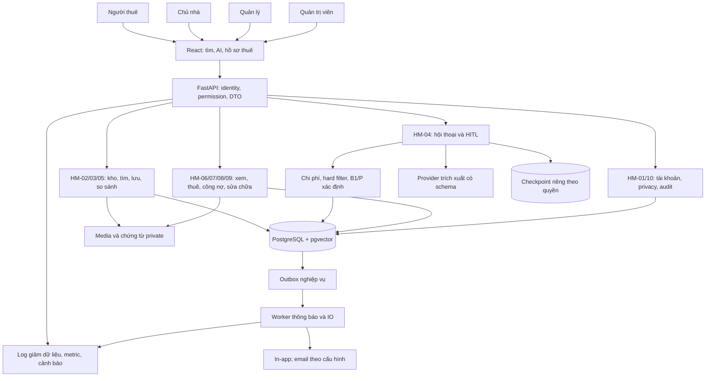
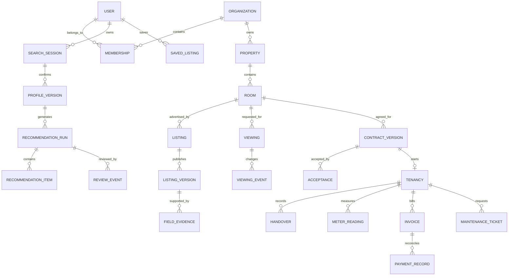

# Kiến trúc sản phẩm HomeMatch

Phiên bản định hướng sản phẩm: 04/10/2026. HomeMatch quản lý toàn vòng đời thuê: tìm chỗ ở → xem phòng → thỏa thuận → hợp đồng → vào ở → chi phí và thanh toán ghi nhận → sửa chữa → trả phòng. Đây là kiến trúc đề xuất của HomeMatch dựa trên nghiên cứu trải nghiệm HubHome, không mô tả công nghệ hoặc backend của HubHome.

Đọc cùng [đặc tả sản phẩm](dac-ta-san-pham.md), [yêu cầu](yeu-cau-san-pham.md), [quy trình](quy-trinh-nghiep-vu.md), [nghiệm thu](tieu-chi-nghiem-thu.md) và [API v1 đề xuất](api-san-pham-v1.md). Cả HM-01 đến HM-10 là phạm vi bắt buộc của sản phẩm hoàn thiện. API đang chạy vẫn là [0.3.0](api-contract.md); sơ đồ và mô hình đích dưới đây không phải chức năng đã triển khai.

## 1. Cơ sở thiết kế và hiện trạng

[Nghiên cứu công khai cập nhật 04/10/2026](nghien-cuu-hubhome.md) và [khảo sát phiên đăng nhập 01/10/2026](khao-sat-hubhome-da-dang-nhap.md) cung cấp bằng chứng về workspace tìm phòng, lịch xem, hợp đồng, sổ đối chiếu thanh toán, chi phí sử dụng và sửa chữa. Hướng dẫn công khai mới mô tả cổng chủ nhà, hợp đồng/ký số và thu tiền/công nợ; đây là lời công bố, chưa là workflow proof. Một số màn hình chỉ có mô tả hoặc dữ liệu trống; chưa kiểm chứng toàn bộ luồng hay dashboard chủ nhà. HomeMatch dùng quan sát để xây yêu cầu riêng, không suy rằng HubHome đã giải quyết mọi nghiệp vụ tương ứng.

| Phạm vi | Nền tảng thực tế trong mã 0.3.0 | Khoảng cách đến sản phẩm hoàn thiện |
|---|---|---|
| HM-01 Tài khoản và cách ly dữ liệu | Hai role renter/manager, seed login, token hết hạn/thu hồi, quyền owner/assignment của phiên | Đăng ký, xác minh/khôi phục tài khoản, role owner/admin, membership và cách ly đơn vị chủ nhà |
| HM-02 Kho phòng | JSON import có revision, đọc kho và toggle published/available | CRUD tòa nhà/phòng/tin, media, duyệt tin, hồ sơ nguồn và quyền chủ nhà |
| HM-03 Tìm kiếm | Lọc có cấu trúc trong matching, vị trí và sai số | Catalog công khai, tìm độc lập AI, bản đồ và chi tiết công khai |
| HM-04 AI và chi phí | Draft field status, confirm/CAS, cost/B1/P adapter, graph/HITL và snapshot | Kiểm chứng provider thật, nguồn theo trường và hoàn thiện UX/lỗi/quota |
| HM-05 Lưu và so sánh | So sánh 2–3 phòng từ cùng published/current run | Yêu thích, lịch sử đồng bộ, quản lý/xóa lịch sử, so sánh catalog công khai |
| HM-06 Lịch và hỗ trợ | Requested/confirmed/declined; ticket hỗ trợ nội bộ | Đổi/hủy/hoàn tất/no-show, nhận xử lý ticket, thông báo bền vững |
| HM-07 Hợp đồng và thuê | Chưa có domain/API | Thỏa thuận, hợp đồng phiên bản, chấp thuận, tenancy, bàn giao vào/trả phòng |
| HM-08 Công tơ và công nợ | Cost engine ước tính trước thuê | Chốt số, hóa đơn, ghi chuyển/nhận tiền, đối chiếu và điều chỉnh |
| HM-09 Sửa chữa | Chưa có domain/API | Ticket theo tenancy, ảnh, lịch thợ, tiến độ, hoàn tất và mở lại |
| HM-10 Quản trị và vận hành | Health/readiness, metric trong process, review ledger, script backup/restore | Console admin, audit toàn vòng đời, retention/export/delete, monitoring và restore đã kiểm chứng |

Backend hiện dùng FastAPI, LangGraph, ledger SQLite/PostgreSQL, checkpoint adapter và RLock trong một service. Migration ledger đang ở schema v2. [Báo cáo backend](kiem-chung-backend.md) là nguồn kết quả đã chạy; tài liệu này không nâng bằng chứng offline thành production, model quality hoặc browser evidence.

## 2. Các quyết định kiến trúc

1. Dùng một backend chia module nghiệp vụ, một React app theo vai trò và PostgreSQL làm DB production. SQLite phục vụ offline/demo/test; không giả định hai storage có cùng khả năng cạnh tranh.
2. Giữ **một API worker** đến khi audit transaction, khóa, connection pool và checkpoint trong nhiều process. Worker hàng đợi cho thông báo/IO là thành phần đích bắt buộc, không tự cho phép nhiều API replica.
3. Tài chính, quyền, chuyển trạng thái và công bố do mã xác định quyết định. LLM hiểu ngôn ngữ, hỏi rõ và hỗ trợ trình bày từ công cụ; LLM không tính tiền hoặc ghi quyết định nghiệp vụ.
4. Tách catalog public đã duyệt tin khỏi danh sách AI cá nhân hóa. Catalog public không phải recommendation đã duyệt. Nháp AI ẩn với renter đến khi manager được phân công duyệt và phiên bản còn hiệu lực.
5. Ledger là nguồn sự thật; checkpoint chỉ giữ tiến trình graph. Business event/outbox cùng transaction, xử lý và giao thông báo có idempotency.
6. Cách ly dữ liệu đơn vị chủ nhà tại server. `renter` là người thuê; `organization` là phạm vi quản lý tài sản, không dùng một chữ tenant cho cả hai nghĩa.
7. Gateway thanh toán thật, chữ ký điện tử pháp lý, nền tảng gọi video, AI giọng nói/ảnh và mở rộng toàn quốc là tùy chọn. Ghi nhận/đối chiếu thanh toán, hợp đồng có chứng từ/chấp thuận và đủ 10 module vẫn bắt buộc.

## 3. Sơ đồ tổng thể đích



Module là ranh giới mã/nghiệp vụ; không yêu cầu mỗi module thành microservice. Media dùng adapter lưu trữ riêng có private access, metadata trong DB và tải qua quyền server; nhà cung cấp là quyết định triển khai còn mở. Dịch vụ ngoài cần timeout, retry hữu hạn và lỗi rõ.

## 4. Identity và quyền

Mọi mutation kiểm actor đáng tin, membership/assignment, ownership, trạng thái, revision và idempotency. Vai trò do server cấp; ID user/organization trong payload không cấp quyền.

| Actor | Phạm vi quyền đích |
|---|---|
| Renter | Dữ liệu cá nhân của mình; catalog public; recommendation approved/current của mình; lịch, hợp đồng, hóa đơn và sửa chữa mình là bên liên quan |
| Owner | Tài sản organization của mình; khách đã có viewing/handoff/thỏa thuận; đề xuất lịch/terms; không tự duyệt recommendation thay manager |
| Manager | Tài sản/khách/tenancy được phân công; review, xác nhận lịch, hợp đồng khi được ủy quyền, billing/maintenance trong phạm vi đó |
| Admin | Role/membership, moderation, vận hành/audit; truy dữ liệu nhạy cảm theo tác vụ có lý do và audit, không đọc đại trà |

Renter có thể tìm ở nhiều organization; dữ liệu cá nhân không lộ cho mọi chủ nhà trong catalog. Chủ nhà chỉ nhận dữ liệu cần xử lý khi có yêu cầu hợp lệ. Media, export, notification, background job và audit query dùng cùng quy tắc quyền như API.

## 5. Hai nguồn khám phá phòng

| Luồng | Điều kiện phòng được đọc | So sánh và lịch xem |
|---|---|---|
| public_catalog | Listing đã moderation/published, projection công khai | Listing revision hiện tại; kiểm lại availability/revision khi gửi yêu cầu; không gắn approval AI |
| ai_recommendation | Listing hợp lệ và recommendation approved/current của renter | Item đã công bố của cùng run/scenario; stale chặn đến chạy/duyệt lại |

API đích dùng /v1 (frontend proxy /api/v1); API 0.3.0 hiện vẫn route không prefix và frontend /api. Comparison/viewing refs là discriminated: public_catalog có listing_id + published_revision, server resolve physical_room_id; ai_recommendation có run_id + profile_version + catalog_version + room_ids thuộc cùng published/current run. Không trộn hai mode; compare có 2–3 phòng thực khác nhau.

Catalog public không chứa nháp tin, liên hệ riêng, giấy tờ, hồ sơ khách hoặc diagnostics AI. Detail hiển thị nguồn, ngày cập nhật, độ chính xác vị trí và phí thiếu. Bản đồ không biến tọa độ gần đúng thành địa chỉ chính xác hoặc phút đi lại. Public compare dùng cùng kịch bản người thuê chọn, 2–3 phòng; listing đổi không âm thầm giữ badge đã xác minh.

## 6. Mô hình dữ liệu đích



| Nhóm bảng đích | Ràng buộc chính |
|---|---|
| users/auth_sessions/organizations/memberships/assignments | Role có hiệu lực, session thu hồi; quyền không suy từ chat |
| properties/rooms/listing_versions/moderation_events | physical_room_id ổn định khác listing_id/published_revision; unique(organization,building,room_code); migration room.id hiện tại cần mapping rõ; revision đơn điệu; published khác occupied/reserved/available |
| fee_versions/field_evidence/media_objects | Nguồn theo trường, đơn vị phí, missing khác zero; ownership/access class |
| search_sessions/profile_versions/history/favorites | Profile snapshot không sửa; retention/consent và xóa đúng chủ sở hữu |
| recommendation_runs/items/review_events | Snapshot/version bất biến; một quyết định hiệu lực/run; active run theo CAS |
| viewings/events/support_tickets/notifications/delivery_attempts | Mode/source rõ, transition audit, dedup key, recipient quyền server |
| agreements/reservations/contract_versions/acceptances | Terms snapshot, actor/document hash; reservation interval/expiry và lease allocation theo physical_room_id, convert reservation→lease atomic |
| tenancies/occupants/handovers | Active sau move-in; planned allocation chặn thuê chồng lấn theo phòng thực; bàn giao hiện trạng/chỉ số/cọc |
| meters/readings/tariff_versions/invoices/lines | Reading đầu/cuối, kỳ và đơn giá hiệu lực, ảnh/evidence; issued lines bất biến |
| payment_records/receipts/allocations/reconciliation_events | Khai chuyển khác received/reconciled; điều chỉnh giữ dấu vết |
| maintenance_tickets/events/appointments | Gắn tenancy, lịch/chi phí được xác nhận, completion evidence |
| audit_events/outbox/privacy_requests | Actor/action/resource/version/time/reason, key retry và giảm nhận diện |

Đây là logical schema. Tên bảng, indexes và migration khóa ở P0; không coi các bảng đích đã có trong schema v2.

## 7. Máy trạng thái nghiệp vụ

| Đối tượng | Trạng thái/chuyển đích |
|---|---|
| Tin | draft → submitted → published/changes_requested; sửa tạo revision cần moderation; suspended/archived |
| Recommendation | generating → pending_review → reviewed → published/rejected/needs_revision; no_match/needs_verification/generation_failed/invalidated |
| Viewing | requested → confirmed/declined; cancel/reschedule có event; confirmed → completed/no_show/cancelled. Requested không giữ phòng |
| Handoff | open → in_progress → resolved → closed; reopen về open; assignment/acknowledgment có dữ liệu riêng, giao thông báo khác nhận xử lý |
| Reservation | Chỉ sau thỏa thuận riêng; active → converted/expired/cancelled; hết hạn trả availability bằng transaction |
| Contract | draft → pending_acceptance → active/cancelled; active → termination_pending → ended hoặc expired; acceptance theo terms version |
| Tenancy | planned → active sau move-in handover → ending → closed sau bàn giao ra; planned → cancelled; settlement_status pending/disputed/settled riêng, closed không tự quyết toán tài chính |
| Invoice | Lifecycle status draft/issued/void; payment_status unpaid/partially_paid/paid; overdue tính từ balance > 0 và now > due_at, có thể vừa partial vừa overdue; adjustment liên kết bản gốc |
| Payment | Evidence submitted chưa paid; receipt verified/rejected; verified allocations mới tính balance; dispute/reversal/refund có event |
| Maintenance | submitted → triaged → scheduled → in_progress → resolved → closed; cancelled có lý do; reopen về triaged |

Service quyết định transition. Notification không tự biến invoice thành paid/viewing thành confirmed. Contract activation cần terms snapshot và acceptance của renter cùng owner hoặc manager có ủy quyền. Contract activation tạo allocation theo physical_room_id/kỳ trong transaction chống active contracts/planned allocations giao nhau. Reservation có interval/expiry cùng transaction conflict, convert đóng reserve và tạo lease allocation atomic. Contract expired không tự release occupied trước recorded move-out. Tenancy active và availability occupied chỉ sau bàn giao vào ở. Chứng từ/chấp thuận ứng dụng không được quảng bá thành chữ ký điện tử pháp lý khi chưa có tích hợp được thẩm định.

## 8. Finance: estimate và hóa đơn thực tế

Engine hiện tại dùng Decimal, HALF_UP theo từng dòng đến VND rồi cộng:

```text
monthly_estimate = rent + Σ(unit_price × scenario_quantity)
initial_estimate = deposit + rent × advance_months + one_time + moving + setup
```

Cọc không cộng tháng; trả trước đã gồm tháng đầu. Phí included tạo dòng 0 có nguồn; thiếu phí trả full total null, known subtotal và missing. Không dùng subtotal để tuyên bố đạt trần tổng tháng. Scenario là giả định đã xác nhận.

HM-08 bổ sung engine hóa đơn xác định theo hợp đồng/tariff có version và reading thực tế. Công tơ lưu cumulative reading; usage là delta riêng. Kỳ [start,end), mặc định tariff có hiệu lực đầu kỳ; thay giữa kỳ áp kỳ sau trừ amendment đã chấp thuận và measured boundary reading để chia segment, không tự prorate đoán. Thay công tơ: usage = old_last − old_start + new_end − new_first; unknown segment chặn actual invoice issue. Reading cuối thấp hơn đầu cần sự kiện reset/thay công tơ; kỳ không chồng lấn; prorate có rule/version. Consumption estimate không tự thành reading hoặc hóa đơn. Hóa đơn snapshot kỳ/đơn giá/chỉ số/dòng tiền; đổi tariff không sửa bản issued.

Renter ghi đã chuyển và evidence; người có quyền ghi đã nhận; reconciliation phân bổ vào invoice/tính còn lại. Partial, thừa/thiếu, chứng từ trùng, dispute, hoàn/điều chỉnh có lịch sử. Invoice status và payment_status tách riêng; overdue là cờ tính được, không loại trừ partially_paid. Cọc có deduction proposed/accepted/disputed; dispute hold không tự khấu trừ hoặc financial settlement settled. Chi phí sửa chữa cần payer và chấp thuận của đúng bên chịu tiền hoặc căn cứ terms snapshot đã xác minh; owner duyệt kỹ thuật chưa đủ thu renter, disputed charge chưa ghi phải thu xác định. Gateway là adapter tùy chọn, không điều kiện để có sổ ghi nhận/đối chiếu đầy đủ.

## 9. AI và công bố

Hai graph có vòng đời riêng: chat kết thúc mỗi lượt; recommendation chờ manager. Confirm/CAS tạo profile snapshot/run; draft suy ra chưa là hồ sơ chính thức. Pipeline: validate → hard filter → vị trí → chi phí → eligible set → B1/P → evidence explanation → draft → HITL → validity → renter projection.

B1 dùng cost/preference/location, P thêm semantic fit trên cùng eligible set. Hoa hồng/phòng tồn/chỉ tiêu không vào rank. Semantic text không tiền/liên hệ; query embedding sau confirm có mô tả mềm. Catalog nhỏ dùng exact vector; ANN cần đo recall/filter. Haversine có sai số, không là phút đi lại.

Giữ stale check trước review/publish/read; cache key có toàn profile/scenario/catalog/ranking/quyền, không chia response tài chính giữa khách. Không stream node output/checkpoint/nháp. Chi tiết ở [thiết kế Agent](thiet-ke-agent.md).

## 10. Giao dịch, outbox và recovery

Ghi business record, audit event và outbox trong một transaction. Worker claim/lease từ DB, dùng event ID để gửi/IO; retry/backoff hữu hạn, dead-letter và operator retry. At-least-once phải dedup; không hứa exactly-once từ hàng đợi. Thông báo dùng link kiểm quyền, giảm tiền/PII trong email/push.

Review hiện commit trước resume. Bản đích mở rộng cùng nguyên tắc cho reservation, acceptance, reading close, invoice issue và reconciliation. CAS chặn tab cũ; cùng key/payload replay, key khác payload conflict. Worker thông báo không tự có quyền resume graph. Recovery cần policy lease/stale/checkpoint và crash tests.

Trước nhiều API worker phải kiểm DB lock/CAS, deadlock/retry, pool/thread-safety, graph/checkpointer và writer catalog giữa process. RLock hiện tại không khóa process khác.

## 11. Bảo mật và vận hành

Production cần account lifecycle, rate limit login/API/upload, secret server-side, explicit origins/TLS, private DB/media và migration/rollback plan. Regex redaction hiện chỉ giảm mẫu tiền/email/phone; không bảo đảm hết PII. Không log raw chat/token/giấy tờ/profile tài chính hoặc đưa vào vector.

Opt-out lưu history khác checkpoint/ledger tối thiểu cần vận hành; purpose/TTL và quyền phải thông báo rõ, không giữ history bằng tên checkpoint. Retention riêng cho history, preferences, checkpoint, hợp đồng, payment evidence, ảnh công tơ và audit. Export/delete đúng actor/organization, xử lý ràng buộc hồ sơ giao dịch hoạt động; không xóa sổ cần đối chiếu qua nút xóa account. Lý do giữ/thời hạn/quyền truy cập phải rõ, chính sách cần rà soát trước dùng thật.

Monitoring: API errors/latency, auth failures, stale conflicts, provider usage, queue lag/retry, billing failure và backup age. Metric process reset sau restart chưa thay monitoring bền vững. Backup phải gồm DB/ledger/checkpoint/media; restore cô lập rồi kiểm quyền, pending/review, contract/invoice/payment và media links. Script hoặc file dump riêng chưa chứng minh restore đạt.

## 12. Gates và nghiệm thu

| Gate | Đầu ra kiến trúc |
|---|---|
| P0 Contract | Role/membership, state/DTO, fee/terms/retention/version rules và ma trận quyền khóa |
| P1 Accounts/catalog | HM-01/02/10 nền, public projection/media isolation, migrations/import/revision đạt |
| P2 Discovery/AI | HM-03/04/05/06, public/AI isolation, HITL/finance/stale, viewing/handoff/notification và provider evidence đúng mode |
| P3 Operations/lease | HM-07/08/09, notification sau thuê, thuê–chốt số–hóa đơn–đối chiếu–sửa chữa–trả phòng E2E |
| P4 Release | Đủ HM-01..10, bốn role, privacy/audit, restore/rollback, monitoring/runbook có evidence |
| P5 Research riêng | Frozen inputs/protocol, independent labels, B1/P paired metrics; test chức năng không thay research |

API v1/migration/data đích có review trước viết mã, nghiệm thu theo [bộ AC sản phẩm](tieu-chi-nghiem-thu.md). Evidence/manifest cũ giữ lịch sử. ID BE/AG/DATA/EV/INF cũ và checklist 62 việc không còn là nguồn phạm vi sản phẩm hoàn thiện.
