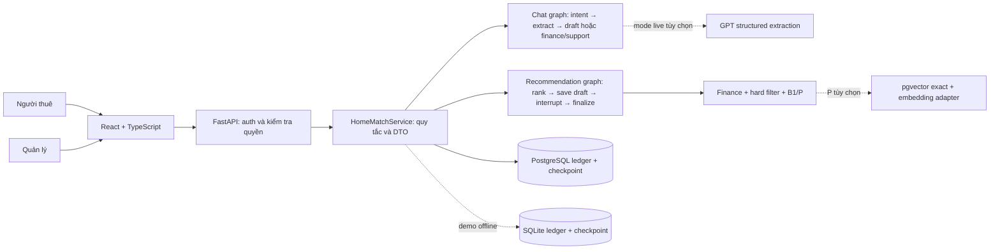
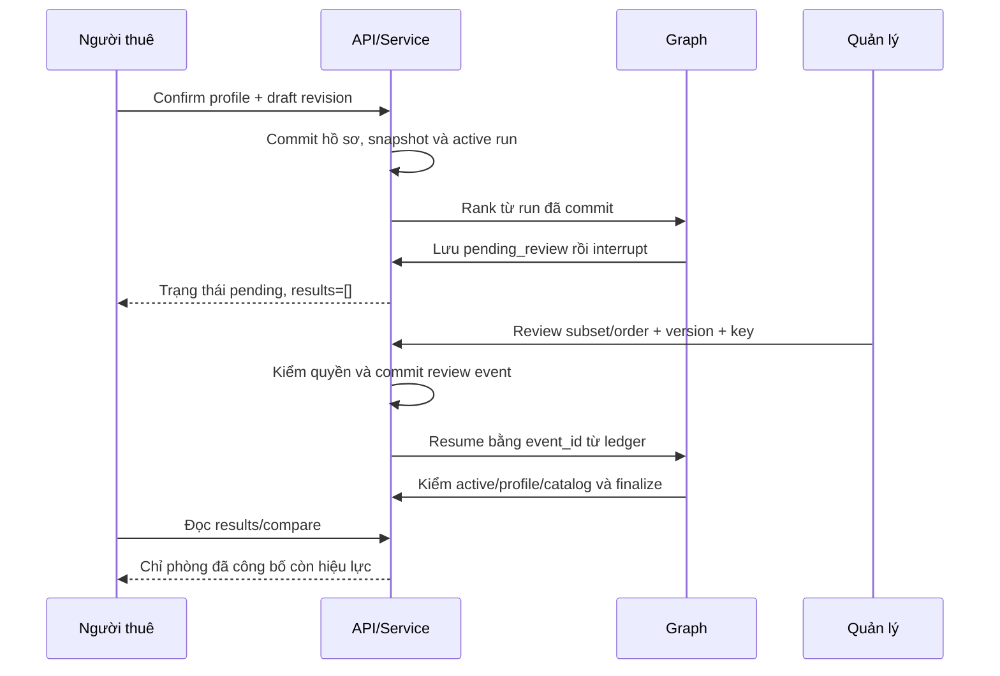

# Kiến trúc bản triển khai local

Tài liệu này mô tả nền tảng local 0.3.0 đang có. [Kiến trúc sản phẩm v1](kien-truc-homematch.md) cập nhật 04/10/2026 giữ vai trò thiết kế toàn vòng đời thuê; [trạng thái](trang-thai-trien-khai.md) tách current/target, các báo cáo kiểm chứng giữ ngày và phạm vi lịch sử. Các thành phần v1 sau thuê chưa có trong sơ đồ local dưới đây.

## Thành phần và trách nhiệm

Frontend không tính điểm, cấp quyền hoặc tự công bố phòng. FastAPI lấy actor từ token server; service kiểm tra owner/manager của phiên. LangGraph điều phối, còn số học, điều kiện cứng, xếp hạng và duyệt chạy bằng code xác định. Đây là hai graph trong một backend, không phải ba dịch vụ LLM tự quyết định.

## Dữ liệu và phiên bản

`hm_schema_migrations` ghi migration ledger; `hm_profile_snapshots` giữ lịch sử hồ sơ với khóa `(session_id, profile_version)`. `hm_sessions` chứa owner, manager, draft revision, hồ sơ đã xác nhận/profile version và active run. `hm_runs` chứa snapshot hồ sơ, catalog version, danh sách nháp, trạng thái và quyết định duyệt. `hm_rooms`/`hm_catalog_meta` giữ kho chuẩn hóa; `hm_users`/`hm_tokens` giữ băm mật khẩu và băm token. `hm_viewings` và `hm_support` giữ yêu cầu nội bộ. Checkpoint LangGraph nằm cùng PostgreSQL hoặc file SQLite riêng khi offline.

- Sửa draft dùng `expected_draft_revision`; chỉ confirm mới tạo phiên bản hồ sơ.
- Một profile version có thể có nhiều run khi retry tạo nháp thất bại; chỉ một active run.
- Kho dùng revision từng phòng và catalog version. Tính hợp lệ/công bố cùng kiểm tra dưới transaction; writer kho phối hợp cùng khóa catalog.
- Token là chuỗi ngẫu nhiên có hạn, server lưu SHA-256 và trạng thái thu hồi. Không có JWT hoặc signing key trong phương án này.

## Luồng duyệt

Finance tổng tháng bao gồm các phí bắt buộc theo scenario. Tiền ban đầu gồm cọc, thuê trả trước, phí một lần, chuyển nhà và sắm sửa; không cộng lại tháng đầu. Khoản thiếu giữ `null`, không thay bằng 0. B1/P dùng cùng tập phòng đủ điều kiện; embedding chỉ chứa đặc tính phòng/ưu tiên, không chứa ngân sách hoặc thông tin liên hệ.

## Giới hạn vận hành

Một API process/worker, không có outbox hoặc worker tự recovery. Retry là thao tác quản lý có kiểm quyền và kiểm trạng thái. Kho dùng dữ liệu tổng hợp, manager có thể đọc/toggle kho chung; session vẫn được phân công. Mode live cần API key và index thật; không xem test fake provider là kết quả chất lượng model. Docker/Railway cần kiểm chứng riêng trước khi ghi đã deploy.

API response contracts nằm trong `backend/app/schemas.py`. `/ready` kiểm migration/catalog/checkpoint; `/manager/metrics` và log `homematch.api` ghi số liệu giảm dữ liệu. Quyết định vẫn còn khi resume lỗi; generation lỗi sau khi nháp lưu được retry bằng run mới. [Báo cáo backend](kiem-chung-backend.md) ghi kiểm chứng SQLite/PostgreSQL và HTTP thật.
