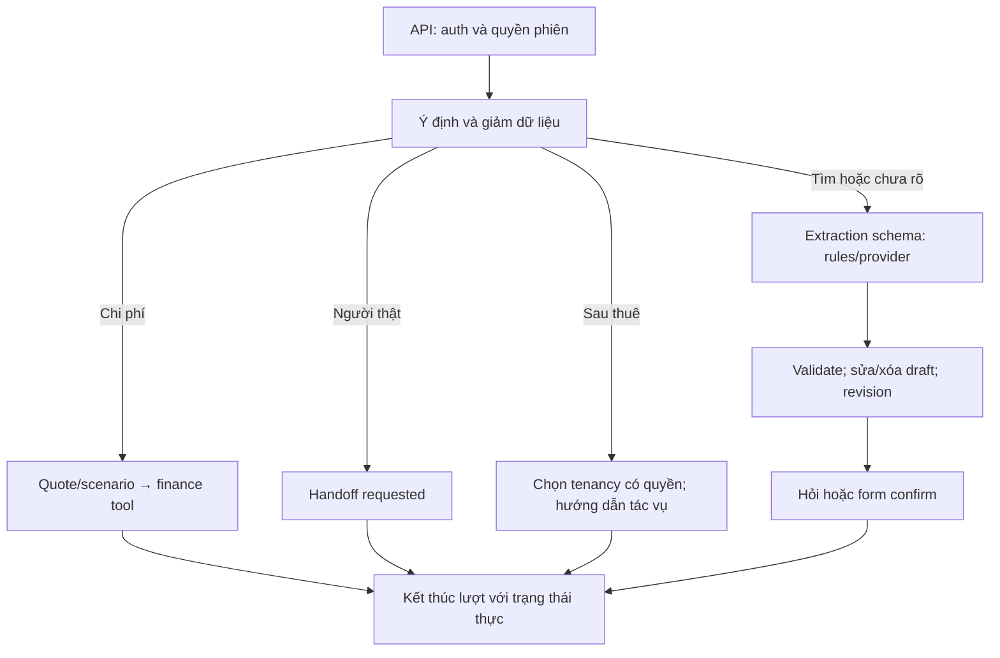
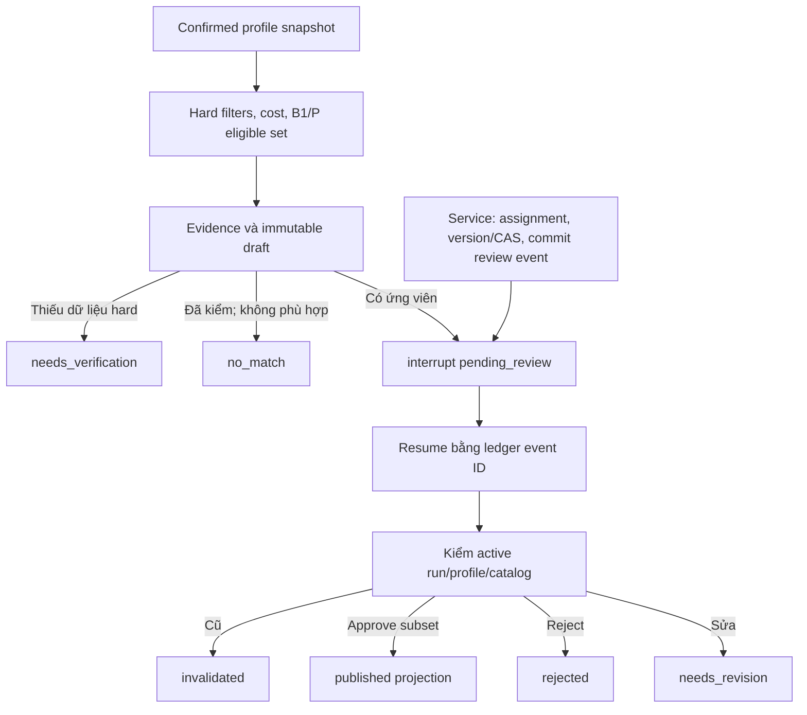

# Thiết kế AI Agent cho sản phẩm HomeMatch

Phiên bản 04/10/2026. Agent là năng lực trong **HM-04**, nối vào hành trình HM-01..10 qua service có quyền. Sản phẩm hoàn thiện bao gồm toàn vòng đời thuê; AI không thay engine tài chính, phê duyệt hoặc quy trình thuê.

Đọc cùng [kiến trúc](kien-truc-homematch.md), [quy trình](quy-trinh-nghiep-vu.md), [yêu cầu](yeu-cau-san-pham.md), [Agent plan](../backend/AGENT_PLAN.md) và [API 0.3.0 hiện có](api-contract.md). Tool/state đích dưới đây không mặc định đã triển khai.

## 1. Hiện trạng và cơ sở nghiên cứu

`interpreter.py` có rule demo/OpenAI adapter; `service.py` có chat graph và recommendation/HITL graph. Draft field status/evidence, confirm/CAS, snapshot run, review commit-before-resume, stale và checkpoint SQLite/PG đã có mã. Hiện chỉ renter/manager, cost/B1 và semantic adapter/fixtures; chưa có evidence chất lượng GPT/P live hoặc tool hợp đồng/billing/maintenance.

[Research công khai 04/10/2026](nghien-cuu-hubhome.md) và [khảo sát HubHome 01/10/2026](khao-sat-hubhome-da-dang-nhap.md) cho thấy cần hỏi rõ, routing chi phí riêng và trạng thái người thật tiếp nhận. Màn hình hợp đồng/hóa đơn trống không chứng minh AI thực hiện giao dịch. HomeMatch đặt yêu cầu riêng từ bài học đó.

## 2. Nhiệm vụ và giới hạn

| Năng lực | Hành vi bắt buộc | Quyết định cuối |
|---|---|---|
| Hiểu nhu cầu | Schema, unknown, hỏi 1–2 mục, sửa/xóa draft | Renter confirm profile/scenario có version |
| Chi phí | Quote/scenario hợp lệ, gọi engine, nêu missing | Finance service tính; renter xác nhận giả định |
| Matching | Hard-filter/rank, evidence explanation, draft | Assigned manager review; service validity/publish |
| Kết quả rỗng | no_match/needs_verification/provider_error riêng; đề xuất nới | Renter chọn/confirm lại; không tự nới hard filter |
| Lịch/handoff | Chuẩn bị yêu cầu, đọc trạng thái đúng quyền | Renter gửi; manager confirm sau phối hợp owner |
| Sau thuê | Hướng dẫn, đọc DTO được phép, mở đúng form | Actor xác nhận qua service nghiệp vụ |

Model không cấp quyền, duyệt tin/run, giữ phòng, chốt hợp đồng, active tenancy, xác nhận nhận tiền, sửa reading/tariff hoặc tự liên hệ bên khác. Mutation nghiệp vụ cần hành động UI rõ, actor có quyền, CAS và consent; câu chat không thay bước đó.

## 3. Routing hội thoại

Routing cost/support rõ hiện dùng rule trước interpreter nên có thể 0 model calls. Nhánh sau thuê là đích; nhiều tenancy phải hỏi chọn, không tìm toàn bộ hồ sơ bằng số điện thoại chat. Hỏi theo thứ tự: city/type → nghĩa ngân sách rent/total → người/xe → điểm đến/bán kính → must/soft → tiền ban đầu/usage → confirm. “Thoáng” có thể đề xuất window mềm để kiểm tra, chưa tự thành must; thay/xóa sở thích không merge vô hạn.

## 4. Recommendation graph

Generation có run/thread riêng; retry tạo run mới chưa có approval. Interrupt node chạy lại khi resume nên không ghi quyết định trước ngắt. Service commit event một lần; graph nhận event ID đã xác minh. Ledger là nguồn nghiệp vụ, checkpoint là tiến trình; thiếu checkpoint không publish chỉ từ boolean/event chưa đối chiếu.

Stale check trước review/publish/read. Profile/giá/phí/availability đổi không phục hồi approval nháp cũ qua replay/restart. Worker recovery đích cần lease/idempotency/crash tests; API vẫn một worker đến audit concurrency/checkpointer.

## 5. Public và AI

Public search/detail/compare/viewing đọc listing published revision với `public_catalog`; không có badge approval AI. AI compare/viewing dùng `ai_recommendation` từ item published/current của cùng renter/run/scenario. Agent có thể dẫn đến public detail, nhưng không lấy pending item mở qua public route như đường vòng. Public DTO dựng từ listing độc lập. Stream/notification chỉ trạng thái/link có quyền, không nháp/diagnostics.

## 6. State và tools

Extraction hiện có intent find_room/calculate_cost/human_support/unknown, city/area/type/people/preferences/needs_destination/remove_preferences/soft_description. Không có role/approval hay budget do model quyết định. Mở intent sau thuê cần schema version/regression, không ghi như đã có trong OpenAPI 0.3.0.

| Tool/service | Hiện trạng/hợp đồng | Bảo vệ |
|---|---|---|
| calculate_cost | Hiện có quote/scenario → totals/null/known/missing/lines | Decimal, nguồn/assumptions; không model arithmetic |
| catalog.match | Hiện có confirmed profile → top≤5/diagnostics | Hard filters, canonical, evidence/version |
| confirm_profile | Hiện có expected revision → profile/run | Ownership/CAS; model không tự gọi |
| record_review | Hiện có review/event ID | Assignment, subset, key/version/state |
| compare/request_viewing | Hiện có AI; public mode là đích | Published/current hoặc public revision, timezone/key |
| request_support | Hiện có requested; lifecycle đích | Chưa assigned/accepted thì không nói đã kết nối |
| Read contract/invoice/maintenance | Đích HM-07/08/09 | Permission/DTO tối thiểu; không gửi raw chứng từ mặc định |
| Prepare form/navigation | Đích | Actor kiểm tra/xác nhận; không chốt terms/payment/reading từ model |

Tool allowlist theo intent/role/resource và server kiểm lại từng lần. Output tool/upload/tin/chat là dữ liệu, không chỉ dẫn đổi policy/tool. Lỗi tool phải trả lỗi thật, không tạo phòng/tiền/lịch bịa.

## 7. Grounding và finance

Estimate tổng tháng/ban đầu khác hóa đơn thực tế. Consumption scenario không phát hành invoice. Missing khác 0; included có nguồn; trả trước không đếm tháng đầu hai lần; cọc không cộng tháng. Explanation dùng line items/evidence/version/tradeoffs; unknown không thành true; Haversine không thành phút đi lại.

B1/P cùng eligible set/cost/catalog. P thêm semantic fit; fallback B1 có nhãn rõ, Eval ghi P unavailable nếu không semantic thật. Template/tool evidence là mặc định; claim thiếu nguồn không hiện như sự thật.

## 8. Provider và privacy

Mã hiện dùng Responses parse schema, store=False, timeout 20 giây, tối đa một retry SDK, output cap 600 và context cap 4.000 token ước lượng. Default demo không gọi API; model/env ở [inventory](../infra/env-inventory.md). Đây là cấu hình thực tế, chưa cam kết model quality.

Đích cần quota/rate limit, ngân sách cưỡng chế, usage/token/latency/retry thực, prompt/model/schema version và giới hạn tool/steps. Regex hiện chưa bao phủ mọi PII. Form tài chính đi engine, không vector; không gửi hợp đồng/giấy tờ/payment evidence cho provider mặc định. Error/refusal/incomplete chuyển form và AI unavailable, không tự đổi model hoặc bịa.

Context gồm draft chuẩn hóa và lượt hiện tại, không transcript toàn bộ. Opt-out history vẫn có minimum operational checkpoint/ledger theo purpose/TTL được thông báo, không lưu transcript bằng tên checkpoint. History HM-05 có retention/export/delete, tách preferences confirmed và checkpoint. Memory xuyên phiên chỉ consent data có thể sửa/xóa, không ngầm nhớ ngân sách/liên hệ.

## 9. Nghiệm thu và bàn giao

| Gate | Evidence Agent |
|---|---|
| P0 | Schema/tool/intent/permission/state; current/target contract riêng |
| P2 | Routing/draft/fallback/cost/grounding, HITL/rights/stale/replay/restart, public/AI isolation, viewing/handoff/notification |
| P3 | Read/navigation sau thuê đúng quyền, actor confirm, contract/billing/repair notifications đúng trạng thái |
| P4 | Errors/quota/injection fixtures, PII/log review, browser E2E/runbook |
| P5 riêng | Frozen config, field F1/intent/ambiguity, paired B1/P, grounding/usage; machine/review latency riêng |

Fake client chỉ chứng minh payload/limits/error handling. Dataset tổng hợp chưa chứng minh thị trường/hài lòng. Model quality cần provider thật, protocol/split khóa và labels độc lập. Nhiều node không tự là multi-agent; nhiều agent tự trị là thử nghiệm tùy chọn có nhiệm vụ/evidence riêng.

ID AG-01..09 cũ là lịch sử. Đầu việc đích theo HM modules ở [plan chi tiết](../backend/AGENT_DETAILED_PLAN.md); checklist MVP không còn là điều kiện hoàn thiện sản phẩm.
