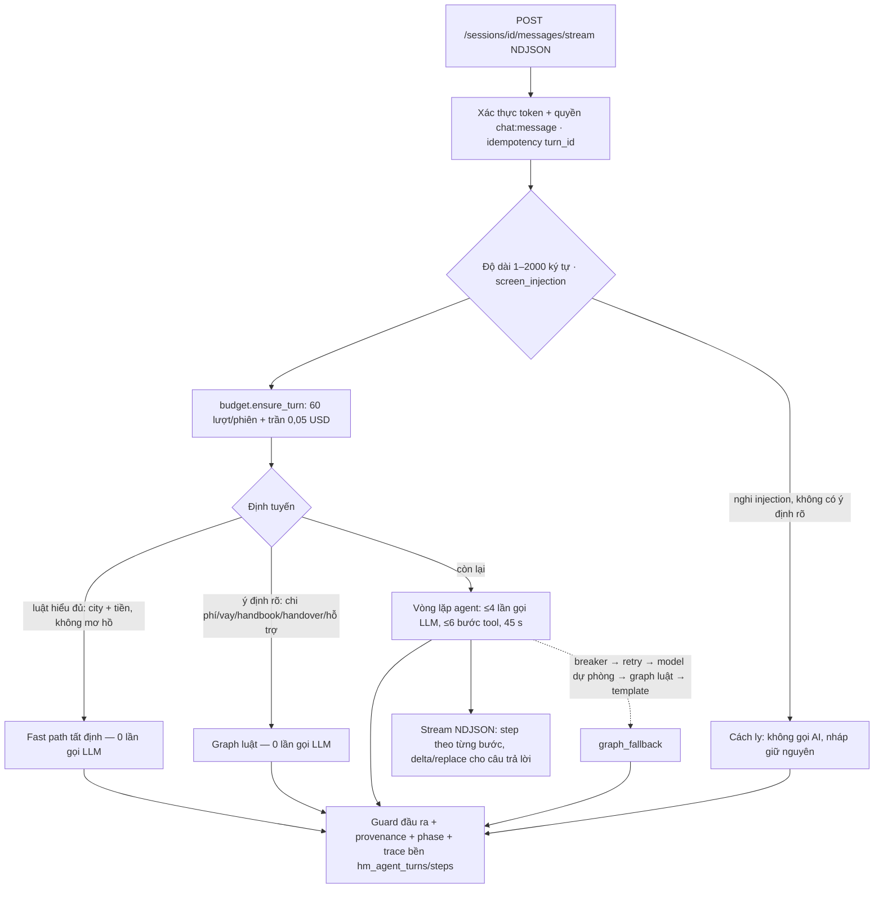

# Nghiệp vụ hiện có và harness của AI Agent HomeMatch

**Cập nhật:** 06/11/2026, đối chiếu trực tiếp với code (schema v21). Mục 2 viết lại theo kiến trúc harness mới (HN-00…HN-12); kiến trúc agent chi tiết ở [thiet-ke-agent.md](thiet-ke-agent.md). Bước "chủ nhà duyệt gợi ý" đã bị bỏ (D-10, 05/11/2026) — kết quả công bố ngay sau xếp hạng.

"Harness" ở đây là toàn bộ phần code **bao quanh mô hình ngôn ngữ**: định tuyến, công cụ được phép gọi, kiểm tra quyền, chặn prompt injection, giới hạn lượt gọi, ghi nguồn gốc câu trả lời, chờ người duyệt, và bộ đánh giá. Nguyên tắc xuyên suốt: **LLM chỉ hiểu ngôn ngữ, code quyết định.** Tiền, điều kiện cứng, điểm xếp hạng, quyền và việc công bố đều do code tất định xử lý.

---

## 1. Nghiệp vụ theo vai trò

| Vai trò | Tài khoản mẫu | Vào từ |
|---|---|---|
| Người thuê (`renter`) | `renter-a`, `renter-b` | `/tro-ly-ai`, `/tim-kiem`, `/nguoi-thue/*` |
| Chủ nhà (`owner`) | `owner-a`, `owner-b` (TP.HCM), `owner-c`, `owner-d` (Hà Nội) | `/chu-nha/*` |
| Quản trị viên (`admin`) | `admin-a` | `/quan-tri/*` |
| `manager` (sale cũ) | — | Còn đăng nhập được, không có quyền nghiệp vụ |

### 1.1. Người thuê

| Nhóm | Nghiệp vụ | API chính |
|---|---|---|
| Tư vấn AI | Mở phiên, chat nhu cầu (chip làm rõ từ kho + Jev), sửa nháp hồ sơ, **xác nhận hồ sơ** → kết quả **công bố ngay** (D-10, không còn chờ chủ nhà duyệt) | `POST /sessions`, `/messages`, `PATCH /draft`, `/confirm`, `GET /results` |
| Trong chat | Hỏi tính chi phí, mô phỏng vay, hỏi cẩm nang/nội quy, yêu cầu gặp người thật (tạo ticket), chuẩn bị đặt lịch | Cùng `/messages`, định tuyến theo ý định (mục 2.3) |
| Sau khi có gợi ý | So sánh 2–3 phòng (kèm lời khuyên AI), mô phỏng 1–3 kịch bản chi phí, đặt lịch xem (trực tiếp hoặc Jitsi), chat với chủ nhà kèm ngữ cảnh phiên | `/compare`, `/simulate`, `/sessions/{id}/viewings`, `POST /conversations` |
| Tìm kiếm thường | Lọc theo thành phố/quận/loại/giá, xem nhanh, bản đồ Leaflet, so sánh, đặt lịch không cần AI | `GET /listings`, `/listings/{id}`, `/listings/compare`, `/listings/{id}/viewings` |
| Sau khi thuê | Xem và chấp thuận hợp đồng (click-accept theo phiên bản), xem hóa đơn, báo đã chuyển tiền (claim), báo hỏng kèm ảnh | `/leases/*`, `/invoices/*`, `/payment-claims`, `/maintenance` |
| Tài khoản | Hồ sơ, đồng ý/rút ghi nhớ (memory), xóa từng trường nhớ, xem và thu hồi phiên đăng nhập, thông báo trong app | `/me/*`, `/notifications` |

### 1.2. Chủ nhà

| Nhóm | Nghiệp vụ | API chính |
|---|---|---|
| Tài khoản | Tự đăng ký → xác minh email → chờ admin duyệt. Khi đang chờ: được soạn tin nháp, **không** được công khai | `/auth/register`, `/auth/verify` |
| Khách tiềm năng | Nhận lead khi căn của mình lọt top 5 gợi ý (kèm băng khả năng chi trả, **không thu nhập**) — thay cho bước duyệt đã bỏ | `/landlord/leads` |
| Tin đăng | Tạo/sửa phòng, đổi trạng thái (còn/đã cọc/đã thuê), ảnh (tải lên, sắp xếp, xóa), ưu đãi có hạn | `/landlord/rooms/*` |
| Co-pilot | Soạn bài đăng theo kênh, link chia sẻ, trang công khai `/tin/:id`, gợi ý giá theo phòng tương tự, trợ lý theo luật có nhập giọng nói | `/marketing`, `/price-advice`, `/landlord/assistant` |
| Khách & lịch | Hộp thư với khách, khách tiềm năng (lead), trả lời yêu cầu xem phòng, phân tích | `/conversations`, `/landlord/leads`, `/viewings/{id}/respond`, `/landlord/analytics` |
| PMS | Hợp đồng có phiên bản (gửi, sửa → tăng phiên bản, khách chấp thuận lại, kích hoạt, gia hạn, chấm dứt), chỉ số công tơ, hóa đơn bất biến, ghi nhận thanh toán, duyệt claim, sửa chữa, dashboard | `/landlord/leases/*`, `/landlord/invoices/*`, `/landlord/payment-claims/*`, `/landlord/dashboard` |

### 1.3. Quản trị viên

- Xem hội thoại AI đã che PII (lưu 90 ngày; mỗi lần mở đều ghi audit), số liệu chuyển giao, chi phí AI quy ra VND.
- Duyệt/từ chối chủ nhà tự đăng ký (từ chối bắt buộc ghi lý do).
- Xử lý ticket hỗ trợ: `requested` → `in_progress` → `resolved`, mở lại được.
- Ẩn/hiện tin, xem người dùng, chạy job nền, khởi tạo lại bản gợi ý bị lỗi.
- **Không** sửa hợp đồng hay hóa đơn thay các bên.

### 1.4. Tự động hóa (job nền)

Chạy trong chính tiến trình API, mỗi `HOMEMATCH_JOBS_INTERVAL_SECONDS` (mặc định 300 giây), hoặc bằng `python -m backend.manage jobs`. Mỗi lần chạy ghi vào `hm_job_runs`. Thông báo có khóa chống trùng.

| Job | Việc |
|---|---|
| `viewing_reminders` | Nhắc lịch xem sắp tới |
| `lead_reengagement` | Gợi ý phòng tương tự cho khách quan tâm nhưng chưa đặt lịch (kèm ưu đãi nếu còn hạn) |
| `payment_reminders` | Nhắc hóa đơn đến hạn |
| `lease_renewal_reminders` | Nhắc gia hạn hợp đồng |
| `transcripts_purged` | Xóa hội thoại AI quá hạn lưu |

### 1.5. Thay thế tích hợp ngoài (D-07, D-08)

Không có cổng thanh toán, email/SMS thật (dùng bản giả lập, ghi log), tự động đăng mạng xã hội (chỉ tạo nội dung và link chia sẻ), hay ký điện tử có giá trị pháp lý (chỉ click-accept).

---

## 2. Harness của AI Agent

> Kiến trúc chi tiết (sơ đồ lượt, registry tool, lớp hỏi lại, guardrail, eval) ở [thiet-ke-agent.md](thiet-ke-agent.md). Mục này tóm tắt các lớp kiểm soát và biến vận hành.

### 2.1. Một lượt chat đi qua những lớp nào

### 2.2. Các lớp kiểm soát

| Lớp | Làm gì | Ở đâu |
|---|---|---|
| **Quyền theo hành động** | Bảng tĩnh `hành động → vai trò` (`session:create`, `chat:message`, `profile:confirm`…), cộng kiểm tra **sở hữu bản ghi**. Output của mô hình không thể thêm hay cấp quyền | [agent_capability.py](../backend/app/agent_capability.py), [capabilities.py](../backend/app/capabilities.py) |
| **Trường đặc quyền** | Payload chứa `role`, `approved`, `permissions`… từ mô hình bị **từ chối** | `assert_unprivileged` |
| **Chặn prompt injection** | 6 nhóm mẫu (bỏ dấu) vào: bỏ qua hướng dẫn, đổi vai, dò prompt, leo quyền, gọi tool/SQL, dò key. Nghi nhiễm → **cách ly** lượt | [agent_guard.py](../backend/app/agent_guard.py) |
| **PII / thu nhập** | `redact` che SĐT/email/tiền trước LLM và Jev; `decision_context` bỏ đệ quy trường `*_vnd`/income/loan; transcript lưu bằng `mask_pii`; thu nhập không bao giờ tới DTO chủ nhà, prompt hay cassette | `agent_guard.py`, `conversations.py`, `decisions.py` |
| **Registry tool** | Mỗi tool khai báo một lần: schema Pydantic, `writes`, `timeout_s` 8 s, `view`, capability, `phases`. Allowlist theo agent + pha; kết quả chuẩn `{ok,data}`/`{ok,error,message,hint}` | [agent_tools.py](../backend/app/agent_tools.py) |
| **Giới hạn vòng lặp** | ≤ 6 bước tool (`agent_step_limit`), ≤ 4 lần gọi LLM, 45 s/lượt, tool > 8 s → `tool_timeout`; vượt → `SAFE_REPLY`, nháp vẫn lưu | [agent_loop.py](../backend/app/agent_loop.py) |
| **Ngân sách phiên** | `HOMEMATCH_SESSION_TURN_BUDGET` (60 **lượt chat** cần AI) + `HOMEMATCH_SESSION_COST_CAP_USD` (0,05 từ `usage.cost`) → 429 `budget_exceeded`. Route tất định không tốn lượt — lối thoát luôn còn | [agent_budget.py](../backend/app/agent_budget.py) |
| **Guardrail vào** | Dữ liệu tool (mô tả tin đăng) vô hiệu giá trị chứa mẫu injection rồi bọc khối *untrusted* trước khi trả model | `neutralize_untrusted` |
| **Guardrail ra** | `check_numbers` (số phải từ câu khách/tool) · cấm nhắc thu nhập · cấm tuyên bố "đã đặt lịch/thanh toán/liên hệ" thiếu tool · cấm tự nhận nới → thay template + bước `guard_output` | `guard_output` |
| **Đường lui** | breaker (5 lỗi/60 s → bỏ qua 120 s) → retry 1 lần (backoff 0,5 s) → `HOMEMATCH_AGENT_FALLBACK_MODEL` → graph luật → template. Jev lỗi → luật | `provider_breaker.py`, `_call_model` |
| **Nguồn gốc (provenance)** | `source` ∈ {user, deterministic-engine, interpreter}, `node`, `agent_mode` (loop/fast_path/graph_fallback), `phase`, tool đã gọi | [agent_provenance.py](../backend/app/agent_provenance.py) |
| **Trace bền** | `hm_agent_turns` + `hm_agent_steps` (schema v20/v21): phase, token, cost USD, outcome, error_code, từng bước đã redact; `GET /admin/agent-turns` (audit `agent_turns.viewed`) | `_write_agent_turn_record`, `main.py` |

### 2.3. Định tuyến và pha

1. **Ý định rõ (`fixed_intent`)** — không tốn LLM: "nếu vay…/trả góp" → `simulate_finance`; "tính chi phí" → `calculate_cost`; "chat với chủ nhà" → `landlord_handover`; "người thật" → `human_support`; "nội quy/hoàn cọc/pháp lý" → `handbook`.
2. **Fast path (HN-01)** — luật trích đủ thành phố + tiền, không mơ hồ: patch → lớp hỏi lại → confirm, `agent_mode="fast_path"`.
3. **Vòng lặp agent (AG-13)** — model tự gọi tool qua registry; **pha** lọc bộ tool: `interview` (chưa có kết quả) → `results` (đã published) → `transaction` (đã có lịch xem/hội thoại chủ nhà) — suy từ trạng thái phiên, không LLM; `phase` ghi vào trace.
4. **Lớp hỏi lại (HN-02)** — `ask_user(field)` → `build_clarification` đếm căn toàn tập kho cho từng cách hiểu → Jev (`typesafe/jev-1.14`, lỗi → luật) → chip có `count/patch/decided_by`; ngưỡng 0,85/0,40/0,2 hiệu chỉnh trên 40 ca gold (`eval clarify`). Confirm khi còn mơ hồ → lỗi cấu trúc `needs_clarification`.

### 2.4. Công cụ theo pha

| Pha | Tool cho model | Ghi |
|---|---|---|
| `interview` | find_place, update_needs, search_rooms, confirm_and_search, ask_user, search_handbook | Tool kết quả/giao dịch ẩn — model không thấy, gọi nhầm bị chặn |
| `results` | + room_details, estimate_cost | Có kết quả published |
| `transaction` | + prepare_viewing, open_landlord_chat | Đã có lịch xem hoặc hội thoại chủ nhà |

Nội bộ graph vẫn có tool riêng (`extract_needs`, `update_draft`, `read_memory`, `calculate_cost`, `match_catalog`…) không gửi model; mọi gọi nghiệp vụ đi qua `ToolBox.call` với allowlist tĩnh.

### 2.5. Kết quả công bố ngay (D-10, 05/11/2026)

- Khách xác nhận hồ sơ (`expected_draft_revision`) → `rank → publish` trong một lượt: có căn là `published` ngay (top 5, kèm tổng số căn khớp), không có là `no_match`; thiếu dữ liệu không còn là trạng thái riêng (D-12): tin thiếu phí/sức chứa hiện ngay kèm nhãn, `needs_verification` chỉ còn ở run lịch sử. Không còn `interrupt()`, không còn trang duyệt của chủ nhà.
- Chủ nhà biết nhu cầu qua **lead**: căn của họ lọt top 5 → `touch_lead(source="recommended")` với băng khả năng chi trả, không thu nhập.
- Hồ sơ mới xác nhận → kết quả, so sánh, lịch xem cũ `invalidated`. Kho đổi version → xếp hạng lại và so với danh sách đã lưu: khác mới `invalidated`, giống hệt thì giữ (D-11).

### 2.6. Dữ liệu nhạy cảm và ghi nhớ

- **Chủ nhà không bao giờ thấy thu nhập.** Projection bỏ `monthly_income_vnd` và `housing_ratio = null` (tỷ lệ cộng gánh nặng sẽ suy ra thu nhập); lead và ngữ cảnh handover chỉ mang băng tài chính. Thu nhập cũng không vào prompt, Jev, embedding hay cassette.
- **Memory** chỉ nhớ thành phố, quận, loại, số PN, sở thích, mô tả mềm khi khách đồng ý; không nhớ tiền/thu nhập/vay/điểm đến; rút đồng ý là xoá.
- **Transcript** đã che PII, xoá theo `HOMEMATCH_CHAT_RETENTION_DAYS`; admin mở là có audit; trace agent (`hm_agent_turns/steps`) cũng theo retention và không lưu prompt/câu trả lời thô.
- **Xếp hạng không dùng thuộc tính thương mại** (hoa hồng, thời gian đăng) — `eval invariants` kiểm.
- **Tóm tắt hội thoại** (`hm_sessions.summary_json`, HN-04) cập nhật mỗi 4 lượt bằng 1 lần gọi LLM rẻ không tools, redact hai chiều — không tiền/SĐT/email/thu nhập.

### 2.7. Đánh giá, tái lập và kiểm thử

| Công cụ | Kiểm gì |
|---|---|
| `pytest` (backend + eval) | 657 test offline trên SQLite; thêm PG khi `HOMEMATCH_TEST_DATABASE_URL`. Test luôn dùng provider giả, không gọi API trả phí |
| `vitest` (frontend) | 109 test UI, 25 file |
| `python -m eval agent --mode demo` | 44 kịch bản nhiều lượt (completion, nháp, câu hỏi, p50/p95 offline); `--mode live` phải `--allow-live` + ngân sách |
| `python -m eval clarify` | precision/recall/top-1 của lớp hỏi lại trên 40 ca gold |
| `HOMEMATCH_AGENT_RECORD/REPLAY` | Cassette JSON ghi/phát lại lượt live (model + Jev, đã redact) — tái lập bằng chứng không tốn phí |
| `python -m eval …` | `validate`, `oracle`, `extraction`, `ranking`, `metrics`, `invariants`, `intents`, `invoices`, `grounding`, `measure`, `report`, `label-sheet`/`label-report`/`survey-report` (công cụ gắn nhãn, **chưa có dữ liệu người**) |
| `infra/smoke_api.py` | Luồng API đầu-cuối offline: đăng nhập → chat → xác nhận → kết quả công bố |
| `infra/check-local.sh` | Toàn bộ bộ offline: eval (gồm agent demo + clarify) + pytest + vitest + build + demo + smoke |

---

## 3. Dữ liệu và hạ tầng (từ 30–31/10/2026)

- **App chạy trên localhost, DB trên Neon** (project `kltn`, Singapore). Database `homematch` giữ dữ liệu app; database `neondb` giữ các snapshot Chợ Tốt. Khởi động: `bash infra/run-neon.sh`.
- **Kho phòng đang dùng cho app:** snapshot Chợ Tốt `chotot-2026-10-30`, 2.779 phòng (TP.HCM 2.087, Hà Nội 692). Kho giả lập 220 phòng (`data/catalog/rooms.json`) vẫn là nền của **eval**.
- Độ trễ mạng tới Neon khoảng 50–400 ms mỗi truy vấn, nên chat mất khoảng 3–4 giây và xác nhận hồ sơ khoảng 14 giây.

---

## 4. Khoảng trống đã biết (rà lại sau đợt harness, 06/11/2026)

| Vấn đề | Trạng thái 06/11/2026 |
|---|---|
| Đa số tin Chợ Tốt thiếu phí | Vẫn còn — từ D-12 các tin này hiện ngay kèm nhãn "ước tính" (không còn `needs_verification`); budget_scope trên kho này gần như không phân biệt được (gold CL15-20 chưa hỏi được) |
| `room_reference` chỉ nhận `demo-NN` | **Đã sửa** (AG-05): resolver nhận mọi nguồn id + thứ tự + tiêu đề |
| Ngân sách và trace trong RAM | **Đã sửa** (HN-05): `hm_agent_turns/steps` bền; ngân sách phiên vẫn trong RAM (restart đếm lại lượt — chấp nhận cho một worker localhost) |
| Chưa chạy đánh giá live (GPT/pgvector), chưa quay demo trình duyệt, chưa có nhãn và khảo sát | Vẫn còn — cần người dùng duyệt chạy live; xem `review/HARNESS-final.md` |
| Jev `usage.cost` chưa ghi vào cost_usd của turn; chưa quy VND trong panel admin | Đã ghi việc; làm cùng đo chi phí live (HN-08/HN-12) |
| Chi phí xác nhận hồ sơ trên Neon (~14 s) | Đã giảm nhiều bước truy vấn per-row trong harness; chưa đo lại chính thức |
