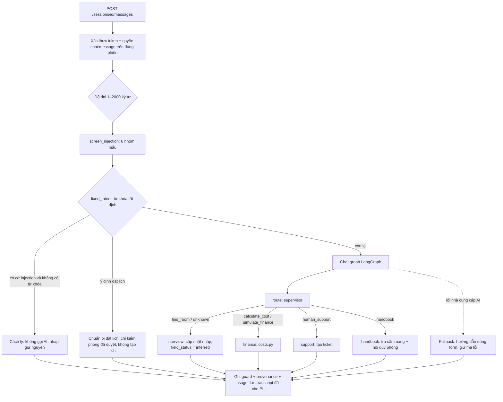
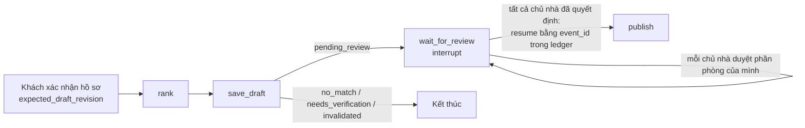

# Nghiệp vụ hiện có và harness của AI Agent HomeMatch

**Cập nhật:** 31/10/2026, đối chiếu trực tiếp với code (schema v13, 110 route API). Tài liệu này thay phần tổng quan của [quy-trinh-nghiep-vu.md](quy-trinh-nghiep-vu.md) (05/10) và [thiet-ke-agent.md](thiet-ke-agent.md) (08/10). Hai file đó vẫn giữ chi tiết lịch sử.

"Harness" ở đây là toàn bộ phần code **bao quanh mô hình ngôn ngữ**: định tuyến, công cụ được phép gọi, kiểm tra quyền, chặn prompt injection, giới hạn lượt gọi, ghi nguồn gốc câu trả lời, chờ người duyệt, và bộ đánh giá. Nguyên tắc xuyên suốt: **LLM chỉ hiểu ngôn ngữ, code quyết định.** Tiền, điều kiện cứng, điểm xếp hạng, quyền và việc công bố đều do code tất định xử lý.

---

## 1. Nghiệp vụ theo vai trò

| Vai trò | Tài khoản mẫu | Vào từ |
|---|---|---|
| Người thuê (`renter`) | `renter-a`, `renter-b` | `/tro-ly-ai`, `/tim-kiem`, `/nguoi-thue/*` |
| Chủ nhà (`owner`) | `owner-a`, `owner-b` (TP.HCM), `owner-c`, `owner-d` (Hà Nội) | `/chu-nha/*` |
| Quản trị viên (`admin`) | `admin-a` | `/quan-tri/*` |
| `manager` (sale cũ) | — | Còn đăng nhập được, không có quyền nghiệp vụ |

### 1.1. Người thuê

| Nhóm | Nghiệp vụ | API chính |
|---|---|---|
| Tư vấn AI | Mở phiên, chat nhu cầu, sửa nháp hồ sơ, **xác nhận hồ sơ** (tạo bản gợi ý), xem kết quả đã được chủ nhà duyệt | `POST /sessions`, `/messages`, `PATCH /draft`, `/confirm`, `GET /results` |
| Trong chat | Hỏi tính chi phí, mô phỏng vay, hỏi cẩm nang/nội quy, yêu cầu gặp người thật (tạo ticket), chuẩn bị đặt lịch | Cùng `/messages`, định tuyến theo ý định (mục 2.3) |
| Sau khi có gợi ý | So sánh 2–3 phòng (kèm lời khuyên AI), mô phỏng 1–3 kịch bản chi phí, đặt lịch xem (trực tiếp hoặc Jitsi), chat với chủ nhà kèm ngữ cảnh phiên | `/compare`, `/simulate`, `/sessions/{id}/viewings`, `POST /conversations` |
| Tìm kiếm thường | Lọc theo thành phố/quận/loại/giá, xem nhanh, bản đồ Leaflet, so sánh, đặt lịch không cần AI | `GET /listings`, `/listings/{id}`, `/listings/compare`, `/listings/{id}/viewings` |
| Sau khi thuê | Xem và chấp thuận hợp đồng (click-accept theo phiên bản), xem hóa đơn, báo đã chuyển tiền (claim), báo hỏng kèm ảnh | `/leases/*`, `/invoices/*`, `/payment-claims`, `/maintenance` |
| Tài khoản | Hồ sơ, đồng ý/rút ghi nhớ (memory), xóa từng trường nhớ, xem và thu hồi phiên đăng nhập, thông báo trong app | `/me/*`, `/notifications` |

### 1.2. Chủ nhà

| Nhóm | Nghiệp vụ | API chính |
|---|---|---|
| Tài khoản | Tự đăng ký → xác minh email → chờ admin duyệt. Khi đang chờ: được soạn tin nháp, **không** được công khai | `/auth/register`, `/auth/verify` |
| **Duyệt gợi ý AI** | Xem danh sách gợi ý có phòng của mình, giữ/bỏ/sắp xếp **chỉ phần phòng của mình**; bỏ hoặc đổi thứ tự phải ghi lý do. Thấy **băng khả năng chi trả** của khách, không thấy thu nhập | `/landlord/recommendations/*` (`review`, `retry`) |
| Tin đăng | Tạo/sửa phòng, đổi trạng thái (còn/đã cọc/đã thuê), ảnh (tải lên, sắp xếp, xóa), ưu đãi có hạn | `/landlord/rooms/*` |
| Co-pilot | Soạn bài đăng theo kênh, link chia sẻ, trang công khai `/tin/:id`, gợi ý giá theo phòng tương tự, trợ lý theo luật có nhập giọng nói | `/marketing`, `/price-advice`, `/landlord/assistant` |
| Khách & lịch | Hộp thư với khách, khách tiềm năng (lead), trả lời yêu cầu xem phòng, phân tích | `/conversations`, `/landlord/leads`, `/viewings/{id}/respond`, `/landlord/analytics` |
| PMS | Hợp đồng có phiên bản (gửi, sửa → tăng phiên bản, khách chấp thuận lại, kích hoạt, gia hạn, chấm dứt), chỉ số công tơ, hóa đơn bất biến, ghi nhận thanh toán, duyệt claim, sửa chữa, dashboard | `/landlord/leases/*`, `/landlord/invoices/*`, `/landlord/payment-claims/*`, `/landlord/dashboard` |

### 1.3. Quản trị viên

- Xem hội thoại AI đã che PII (lưu 90 ngày; mỗi lần mở đều ghi audit), số liệu chuyển giao, chi phí AI quy ra VND.
- Duyệt/từ chối chủ nhà tự đăng ký (từ chối bắt buộc ghi lý do).
- Xử lý ticket hỗ trợ: `requested` → `in_progress` → `resolved`, mở lại được.
- Ẩn/hiện tin, xem người dùng, chạy job nền, khởi tạo lại bản gợi ý bị lỗi.
- **Không** sửa hợp đồng hay hóa đơn thay các bên.

### 1.4. Tự động hóa (job nền)

Chạy trong chính tiến trình API, mỗi `HOMEMATCH_JOBS_INTERVAL_SECONDS` (mặc định 300 giây), hoặc bằng `python -m backend.manage jobs`. Mỗi lần chạy ghi vào `hm_job_runs`. Thông báo có khóa chống trùng.

| Job | Việc |
|---|---|
| `viewing_reminders` | Nhắc lịch xem sắp tới |
| `lead_reengagement` | Gợi ý phòng tương tự cho khách quan tâm nhưng chưa đặt lịch (kèm ưu đãi nếu còn hạn) |
| `payment_reminders` | Nhắc hóa đơn đến hạn |
| `lease_renewal_reminders` | Nhắc gia hạn hợp đồng |
| `transcripts_purged` | Xóa hội thoại AI quá hạn lưu |

### 1.5. Thay thế tích hợp ngoài (D-07, D-08)

Không có cổng thanh toán, email/SMS thật (dùng bản giả lập, ghi log), tự động đăng mạng xã hội (chỉ tạo nội dung và link chia sẻ), hay ký điện tử có giá trị pháp lý (chỉ click-accept).

---

## 2. Harness của AI Agent

### 2.1. Một lượt chat đi qua những lớp nào

Code: `HomeMatchService.message` và `_chat_turn` trong [service.py](../backend/app/service.py).

### 2.2. Các lớp kiểm soát

| Lớp | Làm gì | Ở đâu |
|---|---|---|
| **Quyền theo hành động** | Bảng tĩnh `hành động → vai trò` (`session:create`, `chat:message`, `profile:confirm`, `run:review`…), cộng kiểm tra **sở hữu bản ghi**: khách phải sở hữu phiên, chủ nhà phải sở hữu phòng. Output của mô hình không thể thêm hay cấp quyền | [agent_capability.py](../backend/app/agent_capability.py), [capabilities.py](../backend/app/capabilities.py) |
| **Trường đặc quyền** | Payload chứa `role`, `approved`, `decision`, `keep_room_ids`, `permissions`… từ mô hình hoặc lúc resume graph bị **từ chối**, không được làm theo | `assert_unprivileged` |
| **Chặn prompt injection** | 6 nhóm mẫu trên chữ đã bỏ dấu: bỏ qua hướng dẫn, đổi vai, dò system prompt, leo quyền, gọi tool/SQL, dò mật khẩu/key. Có cờ thì **cách ly** lượt đó: không qua AI, nháp không đổi | [agent_guard.py](../backend/app/agent_guard.py) |
| **PII** | Văn bản được che (`redact`) trước khi vào graph; diagnostics/checkpoint đi qua `redact_tree`; transcript lưu bằng `mask_pii` | `agent_guard.py`, `conversations.py` |
| **Allowlist công cụ** | Mỗi agent chỉ gọi được tool trong danh sách của mình; gọi ngoài danh sách → 403 `tool_not_allowed` | `AGENT_TOOLS` trong [agents.py](../backend/app/agents.py) |
| **Giới hạn bước** | Tối đa **4** lần gọi tool mỗi lượt → 429 `agent_step_limit` | `ToolBox.MAX_STEPS` |
| **Ngân sách lượt gọi AI** | Mỗi phiên tối đa `HOMEMATCH_SESSION_LLM_BUDGET` (mặc định 50) lượt trích xuất → 429 `budget_exceeded`. Nhánh tất định (chi phí, hỗ trợ, đặt lịch) không tốn lượt, nên khách vẫn có lối thoát | [agent_budget.py](../backend/app/agent_budget.py) |
| **Lỗi nhà cung cấp AI** | `ai_unavailable`/`context_limit` → trả hướng dẫn dùng form, **giữ mã lỗi**, không bịa kết quả | `provider_fallback_reply` |
| **Nguồn gốc (provenance)** | Mỗi câu trả lời gắn `source` ∈ {`user`, `deterministic-engine`, `interpreter`} và `node`, kèm danh sách tool đã gọi | [agent_provenance.py](../backend/app/agent_provenance.py) |
| **Theo dõi chi phí** | `usage` (số lượt, token vào/ra) mỗi lượt; admin xem quy ra VND | `metrics.provider_usage`, `/admin/metrics` |

### 2.3. Định tuyến ý định

1. **Từ khóa tất định trước (`fixed_intent`)**, không tốn lượt AI:
   - "mô phỏng vay", "vay … tháng" → `simulate_finance`;
   - "tính chi phí", "tiền vào ở" → `calculate_cost`;
   - "người thật", "gặp chủ nhà" → `human_support`;
   - "nội quy", "hoàn cọc", "pháp lý" → `handbook`.
2. **Còn lại:** node `route` gọi `extract_needs` của interpreter. Ở chế độ `demo` đây là bộ luật; ở chế độ `openai` là GPT structured output, qua Responses API hoặc qua `chat_completions` (OpenRouter). Ý định do bước trích xuất này quyết định.

### 2.4. Năm agent và công cụ được phép

| Agent (node) | Công cụ được phép | Việc |
|---|---|---|
| `needs` (interview) | `extract_needs`, `update_draft`, `read_memory` | Trích xuất nhu cầu, cập nhật nháp với `field_status=inferred` và `evidence_ref`, hỏi tối đa những gì chặn việc tìm (nghĩa số tiền, số người, thành phố chưa rõ, điểm đến). Tự gán thành phố khi khách nêu quận (`locations.city_for_area`) |
| `finance` | `calculate_cost`, `assess_affordability`, `estimate_loan`, `simulate_scenarios` | Mọi con số do [costs.py](../backend/app/costs.py) tính (Decimal, làm tròn VND). Thiếu lãi suất → **hỏi lại**, không tự giả định |
| `ranking` (rank) | `match_catalog`, `semantic_scores`, `explain_candidate` | Lọc cứng, rồi xếp hạng B1 (từ vựng + luật) hoặc P (B1 + pgvector). P không có thì lùi về B1 và ghi rõ `B1_fallback` |
| `support` | `request_support` | Tạo ticket cho admin; không bao giờ nói "đã kết nối người thật" |
| `handbook` | `search_handbook` | Tra cẩm nang nền tảng và nội quy của phòng được nhắc tên |

### 2.5. Con người trong vòng lặp (HITL) — recommendation graph

- Nháp hồ sơ chỉ thành chính thức khi khách bấm xác nhận, kèm đúng `expected_draft_revision`. Số tiền nói trong chat chỉ là **gợi ý** (`budget_hint`).
- Khi chủ nhà đầu tiên duyệt, run chuyển `partially_published` và khách thấy dần các phòng đã duyệt, theo thứ tự của agent.
- Graph chỉ được resume bằng `event_id` có trong sổ nghiệp vụ (`hm_runs`). Payload resume mang quyền hay quyết định bị từ chối (`untrusted_resume`).
- Node trước `interrupt()` **không ghi gì**, vì LangGraph chạy lại node đó khi resume. Ledger là nguồn sự thật, checkpoint chỉ giữ tiến trình.
- Hồ sơ mới được xác nhận hoặc catalog đổi version → kết quả, so sánh, lịch xem cũ bị vô hiệu (`invalidated`).
- Trạng thái run: `generating`, `generation_failed`, `pending_review`, `partially_published`, `reviewed`, `published`, `invalidated`, `no_match`, `needs_verification`, `rejected`, `needs_revision`.

### 2.6. Dữ liệu nhạy cảm và ghi nhớ

- **Chủ nhà không bao giờ thấy thu nhập.** `_landlord_projection` bỏ `monthly_income_vnd` và để `housing_ratio = null`, vì tỷ lệ cộng với gánh nặng trả góp sẽ suy ra được thu nhập. Chủ nhà chỉ thấy băng `phu_hop` / `can_nhac` / `vuot` / `chua_ro`. Thu nhập cũng không đi vào ngữ cảnh chuyển giao, prompt LLM hay embedding.
- **Memory** ([memory.py](../backend/app/memory.py)) chỉ nhớ thành phố, quận, loại phòng, số phòng ngủ, sở thích, mô tả mềm, và chỉ khi khách bật đồng ý `remember_sessions`. Không bao giờ nhớ tiền, thu nhập, khoản vay, điểm đến hay chat thô. Phiên mới chỉ được điền sẵn dưới dạng `inferred`; rút đồng ý là xóa.
- **Transcript** đã che PII, xóa sau `HOMEMATCH_CHAT_RETENTION_DAYS`. Admin mở xem là có audit.
- **Xếp hạng không dùng thuộc tính thương mại** như hoa hồng hay thời gian đăng. `eval invariants` thay đổi các thuộc tính này và kiểm rằng thứ hạng không đổi.

### 2.7. Harness đánh giá và kiểm thử

| Công cụ | Kiểm gì |
|---|---|
| `pytest` (backend + eval) | 285 test trên SQLite; 426 khi bật thêm PostgreSQL (`HOMEMATCH_TEST_DATABASE_URL`). Test luôn dùng interpreter demo, không gọi API trả phí |
| `vitest` (frontend) | 74 test UI, 17 file |
| `python -m eval …` | `validate` (hash dữ liệu đóng băng), `oracle` (chi phí), `extraction`, `ranking`, `metrics`, `invariants`, `intents`, `invoices`, `grounding`, `measure`, `report`, `label-sheet` / `label-report` / `survey-report` (công cụ gắn nhãn và khảo sát, **chưa có dữ liệu**) |
| `infra/smoke_api.py` | Luồng API đầu-cuối: đăng nhập → chat → xác nhận → chủ nhà duyệt → khách thấy kết quả |
| `infra/check-local.sh` | Chạy toàn bộ bộ offline |

---

## 3. Dữ liệu và hạ tầng (từ 30–31/10/2026)

- **App chạy trên localhost, DB trên Neon** (project `kltn`, Singapore). Database `homematch` giữ dữ liệu app; database `neondb` giữ các snapshot Chợ Tốt. Khởi động: `bash infra/run-neon.sh`.
- **Kho phòng đang dùng cho app:** snapshot Chợ Tốt `chotot-2026-10-30`, 2.779 phòng (TP.HCM 2.087, Hà Nội 692). Kho giả lập 220 phòng (`data/catalog/rooms.json`) vẫn là nền của **eval**.
- Độ trễ mạng tới Neon khoảng 50–400 ms mỗi truy vấn, nên chat mất khoảng 3–4 giây và xác nhận hồ sơ khoảng 14 giây.

---

## 4. Khoảng trống đã biết (đọc từ code, 31/10/2026)

| Vấn đề | Ảnh hưởng |
|---|---|
| Đa số tin Chợ Tốt thiếu phí (chỉ 14/2.779 phòng đủ 5 loại phí) | Xác nhận hồ sơ thường ra `needs_verification` thay vì gửi chủ nhà duyệt |
| `room_reference` chỉ nhận mã `demo-NN` ([agent_guard.py:78](../backend/app/agent_guard.py#L78)) | Đặt lịch và hỏi nội quy theo mã phòng thật trong chat không khớp |
| Frontend hiển thị sai `cost_estimate` và làm mất câu hỏi khi có cả `message` | Xem [coding-plan/fe-chat-ai.md](coding-plan/fe-chat-ai.md), FE-C02 |
| Khách không đọc lại được lịch sử chat sau khi tải lại trang | Chưa có API; FE-C07 |
| Ngân sách lượt AI và trace lưu trong bộ nhớ tiến trình | Khởi động lại server là đếm lại từ 0 |
| Chưa chạy đánh giá với GPT/pgvector thật, chưa quay demo trình duyệt, chưa có nhãn và khảo sát | Phần kết quả thực nghiệm của luận văn còn thiếu |
