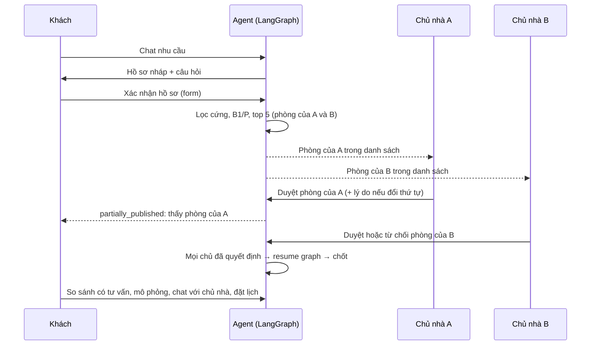
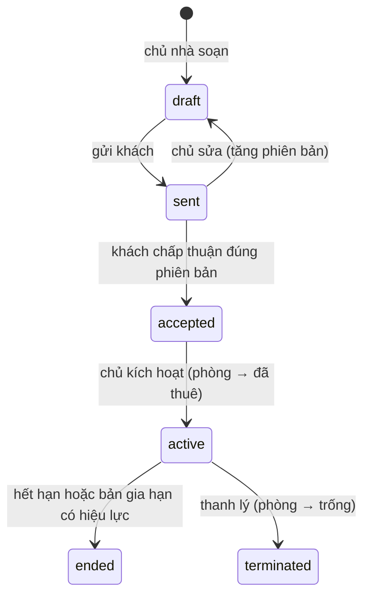

# Quy trình nghiệp vụ HomeMatch AI Agent

**Cập nhật:** 05/10/2026. Mã trạng thái và lỗi API chi tiết ở [status-dictionary.md](status-dictionary.md).

## 1. Ai được làm gì

| Vai trò | Được làm | Không được làm |
|---|---|---|
| Người thuê | Chat, xác nhận hồ sơ, tìm bằng bộ lọc, xem phòng đã duyệt, so sánh, mô phỏng, chat với chủ nhà, đặt lịch, chấp thuận hợp đồng, báo chuyển tiền, báo hỏng, quản lý memory | Thấy nháp chưa duyệt; thấy dữ liệu của người khác |
| Chủ nhà | Duyệt phòng của mình trong danh sách AI; quản lý tin, lịch xem, hộp thư, khách tiềm năng, hợp đồng, công tơ, hóa đơn, thu tiền, sửa chữa; dùng trợ lý AI | Thấy thu nhập hay tỷ lệ thu nhập của khách; thấy hay sửa phòng của chủ khác; đẩy phòng mình lên trước phòng chủ khác |
| Quản trị viên | Xem hội thoại AI (có audit), số liệu chuyển giao, người dùng, ẩn/hiện tin, chạy job, khởi tạo lại bản gợi ý lỗi | Sửa hợp đồng hay hóa đơn thay các bên |
| Agent | Hỏi, trích xuất, gọi tool trong danh sách cho phép, soạn lý do, trả lời cẩm nang | Xác nhận hồ sơ, duyệt, tính tiền bằng LLM, tự nới điều kiện |

## 2. Từ nhu cầu đến phòng được duyệt

Trạng thái danh sách: `generating` → `pending_review` → `partially_published` (một số chủ đã duyệt) → `reviewed` (mọi chủ đã quyết định) → `published` / `rejected` / `needs_revision`. Danh sách chuyển sang `invalidated` khi hồ sơ hoặc kho thay đổi.

## 3. Tìm trực tiếp và trao đổi

1. Khách lọc tin đã công khai, xem nhanh, xem bản đồ. Mỗi lần mở tin được ghi nhận làm lượt xem; lượt xem cũng cập nhật khách tiềm năng của chủ nhà.
2. Bấm "Chat với chủ nhà" mở cuộc trò chuyện riêng cho phòng đó. Ngữ cảnh chuyển kèm gồm phòng, nhu cầu đã xác nhận, băng tài chính và các lượt chat AI gần nhất đã che PII.
3. Đặt lịch xem: chọn trực tiếp hoặc trực tuyến. Chủ nhà xác nhận hoặc từ chối. Lịch trực tuyến có link phòng họp. Lịch xem không giữ chỗ phòng.

## 4. Thuê và vận hành

- **Hóa đơn:** chốt chỉ số đầu và cuối kỳ (đầu kỳ tự lấy từ kỳ trước) → lập hóa đơn theo bảng phí đã chụp lại khi ký hợp đồng → hạn thanh toán theo ngày trong hợp đồng.
  - Thiếu chỉ số hoặc đơn giá thì không lập được hóa đơn.
  - Hóa đơn đã phát hành không sửa được.
- **Thanh toán:** khách báo đã chuyển (chưa tính là đã thu) → chủ nhà xác nhận đã nhận → ghi thu, phát biên lai. Chủ nhà cũng ghi thu tiền mặt trực tiếp được. Không thu vượt số còn nợ.
- **Sửa chữa:** người đang thuê báo hỏng (mức Khẩn thì chủ nhận thông báo ngay). Luồng trạng thái: `submitted` → `assigned` → `in_progress` → `resolved`. Sau đó khách chọn `closed`, hoặc `reopened` kèm lý do.

## 5. Tự động hóa

Job chạy 5 phút một lần (`HOMEMATCH_JOBS_INTERVAL_SECONDS`). Có thể chạy tay bằng `python -m backend.manage jobs` hoặc từ Admin Console. Mỗi thông báo có khóa chống trùng.

| Sự kiện hoặc job | Người nhận |
|---|---|
| Yêu cầu xem mới | Chủ nhà |
| Lịch xem được xác nhận hoặc từ chối | Khách |
| Nhắc lịch xem trong 24 giờ | Khách, chủ nhà |
| Chủ nhà duyệt phòng | Khách |
| Tin nhắn mới, cuộc trò chuyện mới | Bên còn lại |
| Phòng đổi trạng thái, giá, bảng phí, bị ẩn | Khách đã xem trong 30 ngày, đã đặt lịch hoặc đã chat |
| Khách xem tin trên 24 giờ mà chưa đặt lịch | Khách: gợi ý căn tương đương (một lần) |
| Hợp đồng gửi, chấp thuận, hiệu lực, thanh lý | Bên còn lại |
| Hóa đơn phát hành, sắp đến hạn (3 ngày), quá hạn | Khách; khi quá hạn thì cả chủ nhà |
| Báo chuyển tiền, xác nhận thu, biên lai | Bên còn lại |
| Hợp đồng hết hạn trong 30 ngày | Khách, chủ nhà |
| Sự cố mới hoặc cập nhật | Bên còn lại |
| Chat AI quá 90 ngày | Xóa |

## 6. Ai thấy dữ liệu gì

| Dữ liệu | Khách (chủ phiên) | Chủ nhà | Admin | LLM / embedding |
|---|---|---|---|---|
| Thu nhập, tỷ lệ | Có | Không (chỉ băng) | Không | Không |
| Trần tổng tháng, tiền mặt | Có | Có (trong danh sách và ngữ cảnh chuyển giao) | Không | Không |
| Chat AI | Có | Chỉ các lượt gần nhất đã che PII, khi khách chủ động chuyển giao | Đã che PII, có audit | Văn bản đã tách tiền và liên hệ |
| Phòng trong danh sách AI | Phòng đã duyệt | Chỉ phòng của mình | Toàn bộ (qua vận hành) | Không |
| Hợp đồng, hóa đơn, sự cố | Của mình | Của phòng mình | Không | Không |

## 7. Khu vực

TP.HCM và Hà Nội, tên quận quen gọi. Từ điển tên gọi khác ở `backend/app/locations.py`. Thành phố không bao giờ tự mặc định.
