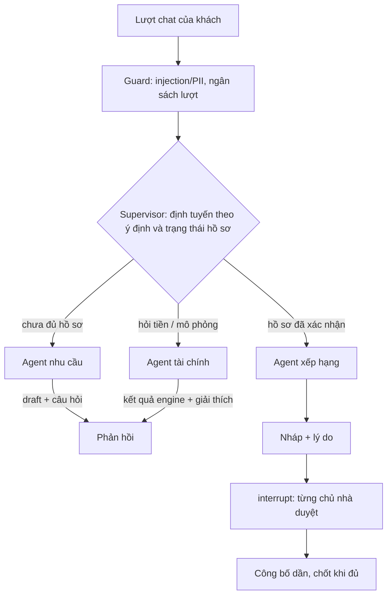

# Thiết kế AI Agent HomeMatch

**Cập nhật:** 05/10/2026 (sau GĐ3). Cụ thể hóa FR-01–FR-04, FR-09–FR-17, FR-21–FR-22 trong [danh mục yêu cầu](yeu-cau-san-pham.md). Multi-agent, memory và cache embedding truy vấn đã có trong code; mục 2 mô tả cấu trúc graph trước GĐ3 để đối chiếu.

## 1. Nguyên tắc

- **LLM hiểu ngôn ngữ, code quyết định.** Số tiền, điều kiện cứng, điểm xếp hạng, quyền và việc công bố đều do code xác định. LLM chỉ trích xuất có cấu trúc và soạn câu hỏi.
- **Không có quyết định nào bỏ qua người.** Khách xác nhận hồ sơ. Mỗi chủ nhà duyệt phần phòng của mình trong danh sách. Agent không tự xác nhận, tự duyệt hay tự nới điều kiện.
- **Dữ liệu người dùng là dữ liệu, không phải lệnh.** `agent_guard.py` sàng lọc prompt injection (cách ly lượt chat bị gắn cờ) và PII. Output của tool không thay đổi được chính sách.
- **Chi phí có giới hạn.** Ý định chi phí và gặp người thật đi nhánh luật, không tốn lượt LLM. Mỗi phiên có ngân sách lượt gọi (`HOMEMATCH_SESSION_LLM_BUDGET`, mặc định 50). Hết lượt thì chuyển sang form.

## 2. Trước GĐ3: hai graph

`backend/app/service.py` có hai `StateGraph`:

1. **Chat graph** (`ChatState`): ý định → trích xuất (`interpreter.py`: luật `demo` hoặc GPT structured output khi `HOMEMATCH_LLM_MODE=openai`) → cập nhật nháp với `field_status`/`evidence_ref` → câu hỏi. Nhánh tính chi phí và hỗ trợ người thật đi riêng.
2. **Recommendation graph** (`RecommendationState`): xếp hạng từ run đã commit → lưu nháp `pending_review` → `interrupt()` → tiếp tục bằng `event_id` quyết định đã commit → kiểm phiên bản → công bố.

Node đứng trước `interrupt()` **không ghi gì**, vì LangGraph chạy lại node đó khi resume. Ledger (`hm_runs`) là nguồn sự thật nghiệp vụ, checkpoint chỉ là tiến trình.

## 3. Multi-agent (FR-21, đã có)

| Agent | Nhiệm vụ | Tool được phép | Không được |
|---|---|---|---|
| Nhu cầu | Phỏng vấn, trích xuất, hỏi tối đa 2 câu, xử lý "bỏ sở thích X" | `extract_needs`, `update_draft`, `read_memory` (khi khách đã đồng ý) | Xác nhận hồ sơ, đọc kho |
| Tài chính | Giải thích chi phí, tính khả năng chi trả, mô phỏng vay và kịch bản | `calculate_cost`, `assess_affordability`, `estimate_loan`, `simulate_scenarios` | Tự sinh số tiền, đổi hồ sơ đã xác nhận |
| Xếp hạng | Lọc cứng, B1/P, soạn lý do và đánh đổi từ diagnostics | `match_catalog`, `semantic_scores`, `explain_candidate` | Đổi trọng số theo từng phiên, dùng thuộc tính thương mại |
| Cẩm nang | Trả lời quyền lợi, quy định chung, nội quy chủ nhà bằng truy xuất | `search_handbook` | Sinh nội dung pháp lý mới |
| Hỗ trợ | Ghi yêu cầu gặp người thật cho admin; gợi ý "Chat với chủ nhà" | `request_support` | Tự liên hệ ai |
| Supervisor | Định tuyến; giới hạn số bước (tối đa 4 node mỗi lượt) | Gọi các agent con | Gọi tool nghiệp vụ trực tiếp |

Cách triển khai: chat graph có các node `route` (supervisor), `interview` (agent nhu cầu), `finance` (agent tài chính), `support`. Recommendation graph giữ nguyên tên node để không làm hỏng checkpoint đang chờ duyệt; node `rank` gọi tool `match_catalog` của agent xếp hạng. Mọi tool đi qua `ToolBox.call` (`backend/app/agents.py`), có danh sách cho phép theo agent và tối đa 4 bước. Gọi ngoài danh sách thì trả lỗi `tool_not_allowed`. Provenance mỗi lượt và `diagnostics.agent` của run ghi `agent`, `tools`, `steps`. Supervisor dùng luật khi ý định rõ; chỉ tool `extract_needs` có thể gọi LLM, nên số lượt gọi LLM mỗi lượt không tăng.

## 4. Trích xuất và hỏi lại

Schema `Extraction` gồm:

- `intent`: `find_room` | `calculate_cost` | `human_support` | `unknown`;
- `city`, `area`, `room_type`, `people`, `preferences`, `remove_preferences`, `needs_destination`, `soft_description`.

Từ GĐ2, `room_type` nhận `apartment` ("căn hộ", "chung cư") và có trường `bedrooms` ("1PN", "2 phòng ngủ"). Ý định `simulate_finance` vẫn là đích.

- Tiền và liên hệ được tách bằng `redact()` trước khi gửi LLM. Tiền chỉ còn là `budget_hint` để gợi ý điền form.
- Thành phố và khu vực nhận diện qua `locations.py`: "Sài Gòn", "HN", "Q7", "q.10", "Bình Thạnh", "Cầu Giấy"… Không suy thành phố từ khu vực và không mặc định TP.HCM.
- Thứ tự hỏi: loại hình/thành phố → tiền nêu ra là tiền thuê hay tổng tháng → số người/xe → điểm đến và bán kính → tiện ích bắt buộc/ưu tiên → tiền mặt và kịch bản vay.
- "Thoáng" hoặc "view đẹp" là sở thích mềm (cửa sổ, ban công, mô tả semantic). Chỉ thành tiện ích bắt buộc khi khách xác nhận.

## 5. Xếp hạng và lý giải

- **Lọc cứng** (`catalog.eligible_candidates`): published → thành phố → khu vực → loại hình → số phòng ngủ → trống/sức chứa → tiện ích bắt buộc → bán kính (cộng sai số) → tiền thuê → tổng tháng → tiền vào ở. Khi có kịch bản vay, bước tiền vào ở được thay bằng hai kiểm tra `loan_principal` và `loan_burden`.
- **B1:** điểm chi phí 0,5, sở thích 0,3, vị trí 0,2. Trọng số chuẩn hóa theo các thành phần có mặt.
- **P:** `(1 − α)·B1 + α·semantic`, α = 0,3. Văn bản semantic của căn chỉ gồm loại hình, tiêu đề, tiện ích; không có tiền hay liên hệ (`private_semantic_text`).
- **Lý giải:** câu mẫu sinh từ thành phần điểm và dòng chi phí, ví dụ "Tổng tháng 7.070.000 VND trong kịch bản đã xác nhận", kèm các đánh đổi "thiếu bằng chứng". Đích: LLM có thể diễn đạt lại cho mượt, nhưng chỉ dùng các khẳng định đã có. `eval grounding` kiểm chứng điều này.
- **Không thiên vị (FR-13):** đặc trưng xếp hạng là danh sách cho phép `cost`, `preferences`, `location`, `semantic`. Thuộc tính thương mại không được đưa vào `components`.

## 6. Memory xuyên phiên

**Đã có (FR-22), module `backend/app/memory.py`, bảng `hm_preference_memory` (migration v4).**

- Chỉ bật khi khách đồng ý `remember_sessions` (trường đồng ý đã có ở `/me/profile`).
- Lưu: sở thích, khu vực, loại hình, mô tả mềm **đã xác nhận** từ các phiên trước, kèm thời điểm. Không lưu nội dung chat thô. Không lưu tiền, thu nhập, khoản vay hay điểm đến.
- Phiên mới: agent nhu cầu điền sẵn các trường với trạng thái `inferred` và nguồn `memory:<phiên>`. Khách phải xác nhận lại. Memory không bao giờ thành `confirmed` trực tiếp.
- Khách xem và xóa từng trường hoặc toàn bộ ở trang Tài khoản (`GET /me/memory`, `DELETE /me/memory[/{field}]`). Rút đồng ý `remember_sessions` thì memory bị xóa, không chỉ bị ẩn.
- Đánh giá: so sánh số lượt hỏi và thời gian đến khi xác nhận hồ sơ, giữa có và không có memory.

## 7. Tối ưu chi phí semantic

| Kỹ thuật | Hiện có | Đích |
|---|---|---|
| Lọc cứng trước, chỉ chấm semantic trên tập đủ điều kiện | Có | Giữ |
| Không gọi embedding khi hồ sơ không có mô tả mềm | Có (`B1_structured_fallback`) | Giữ |
| Cache embedding truy vấn theo hash (model + chiều + văn bản) | Có: `QueryEmbeddingCache`, bảng `hm_query_embeddings`, còn sau khi khởi động lại; đếm `query_cache_hits` / `query_embedding_calls` trong `/admin/metrics` | Giữ |
| Embedding căn: index bằng `backend.manage index --allow-live`, chỉ embed lại khi hash văn bản semantic đổi (`hm_embeddings.text_hash`) | Có | Giữ |
| Giới hạn lượt gọi mỗi phiên | Có (`agent_budget.py`) | Giữ, báo cáo chi phí VND mỗi phiên |
| pgvector exact trên tập nhỏ | Có | Dùng ANN (HNSW) chỉ khi kho đủ lớn, ghi thành protocol riêng |

## 8. Provider và lỗi

- GPT dùng Responses API, structured output, `store=False`, timeout 20 giây, tối đa 1 lần retry, giới hạn output 600 token, giới hạn ngữ cảnh ước tính 4.000 token. Ngữ cảnh gồm nháp đã chuẩn hóa và lượt hiện tại, không gửi toàn bộ transcript.
- Lỗi provider, từ chối hoặc vượt ngữ cảnh → trả `ai_unavailable`/`context_limit` và hướng sang form. Không bịa kết quả trích xuất.
- Metrics: `logical_calls`, `reported_tokens`, `calls_without_token_usage`. Lượt thiếu số liệu usage không được tính là 0 token.

## 9. Kiểm chứng

| Nội dung | Bằng chứng |
|---|---|
| Định tuyến, nháp, hỏi lại, alias khu vực | `backend/tests/test_interpreter_api.py`, `test_locations.py`, `test_agent_*` |
| HITL, phiên bản, replay, khởi động lại | `test_workflow.py`, `test_backend_durability.py` |
| Guard injection/PII, ngân sách lượt | `test_agent_guardrails.py` |
| Chất lượng GPT-4o, P live | Chưa chạy. Cần API key, ngân sách và protocol đã khóa ([eval](../eval/PLAN.md)) |
